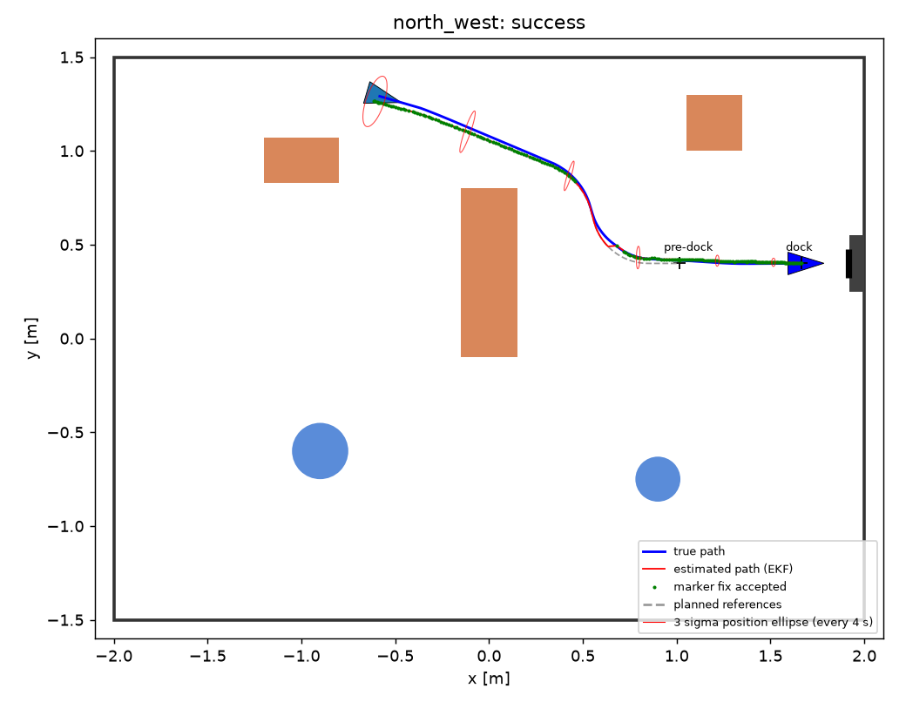

# 41014 Integrated Project, Track A: visual docking of a TurtleBot3 in MuJoCo

A TurtleBot3 Burger in MuJoCo localises itself from an ArUco marker on a charging station, plans a path around the
obstacles in a room, tracks it with an LQR controller acting on an EKF estimate, and docks at the station. The
controller never receives ground truth. Ground truth is read only by `evaluation/` to measure the results.

Status: Stage 1 (end-to-end simulation) working. LiDAR-based navigation (Stage 2) and the Monte Carlo evaluation
(Stage 3) are in progress.



## Setup

```
python -m venv .venv && source .venv/bin/activate
pip install -r requirements.txt
python -m pytest -q
```

Tested on macOS (Apple silicon) with Python 3.12 and MuJoCo 3.15.0, using MuJoCo's default rendering backend. On Linux
without a display, set `MUJOCO_GL=egl` (or `osmesa`) before running. The Linux backends have not been tested.

## Running the simulation

```
python scripts/run_demo.py                 # all five start pads; video of the first
python scripts/run_demo.py --video-all     # a video for every start pad
python scripts/run_demo.py --hidden        # also the two start pads without a view of the marker
```

Output goes to `results/demo/<start>/`: `demo.mp4` (top-down view with the true path, the EKF estimate and its 3 sigma
ellipse, next to the robot camera view), `log.csv`, and plots of the path, the estimation errors with 3 sigma
bounds, NEES and NIS, and the control effort. `results/demo/summary.csv` collects the runs.

To watch a run live in the interactive MuJoCo viewer:

```
python .venv/bin/mjpython scripts/view_live.py --start centre     # macOS
python scripts/view_live.py --start centre                        # Linux
```

## Repository layout

| Path | Contents |
|---|---|
| `src/known_map.py` | the room, obstacles, charging station and marker pose given to the robot (configuration, not ground truth) |
| `src/tb3/` | shared data types, the MuJoCo platform wrapper (odometry, LiDAR), the simulated camera |
| `src/model/` | unicycle and tracking-error models, Jacobians, controllability and observability helpers |
| `src/control/` | LQR tracker (fixed, scheduled, time-varying gains) and the command slew-rate limiter |
| `src/vision/` | camera intrinsics, ArUco detection, pose by solvePnP, measurement noise model |
| `src/estimation/` | EKF: odometry prediction, marker pose update, chi-square gating |
| `src/planning/` | occupancy grid, A*, path smoothing, velocity profile, reference trajectories |
| `src/docking/` | docking trajectory, stop rule, marker search |
| `src/mission.py` | the on-robot pipeline: localise, plan, track, dock |
| `evaluation/` | the only code that reads ground truth: episode runner, calibration and characterisation scripts, metrics, plots, video |
| `scripts/` | scene generation, demo runner, live viewer |
| `config/` | calibration and tuning results read by the pipeline, each written by a script in `evaluation/` |
| `models/` | generated MuJoCo scenes and the marker texture (regenerate with `python scripts/make_track_a_scene.py`) |
| `third_party/` | the unmodified TurtleBot3 model and LDS-01 specification, MIT licence |
| `tests/` | model, platform, structure and closed-loop tests |
| `results/demo/` | the demo run shown below |

## How it works

1. **Localise.** The robot turns towards where its start prior says the marker is, and collects three accepted marker
   fixes before it drives.
2. **Plan.** A* on an occupancy grid of the known map, with obstacles inflated by the robot radius plus a margin,
   then line-of-sight shortcutting, circular-arc corners and a speed profile, giving a time-indexed reference.
3. **Track.** LQR on the linearised tracking-error model, with gains rescheduled along the reference, acting on the
   EKF estimate.
4. **Estimate.** The EKF predicts with calibrated wheel odometry and updates with the marker pose in the robot frame
   (position and yaw), which makes the full pose observable from one marker. A chi-square gate rejects outliers,
   including the two-fold pose ambiguity of a square marker.
5. **Dock.** A smooth curve onto the marker normal, then a slow straight approach. The robot stops when the
   estimated distance to the dock reaches zero, and docking is abandoned for a new marker search if no marker fix
   arrives for 3 s.

Values that come from measurement are produced by scripts and stored in `config/`:

| Value | Script | Result |
|---|---|---|
| Marker range bias and noise model | `evaluation/vision_characterisation.py` | range bias corrected (residual mean within 3.4 mm up to 3.6 m), detection 94 to 99.6 percent when the marker is fully in view, up to 3.6 m |
| In-motion vision noise | `evaluation/vision_dynamic.py` | yaw noise 2.39 times the static model, position within the static model |
| Odometry calibration | `evaluation/odometry_calibration.py` | v scale 0.999, omega scale 0.988 (effective wheel separation 0.162 m) |
| EKF consistency tuning | `evaluation/tune_ekf.py` | process noise x5, yaw measurement std x3: mean NEES 3.05, 1.6 percent of updates gated out |

## Results

One run per start pad, seed 1, from `python scripts/run_demo.py --hidden` (`results/demo/summary.csv`). Docking
success requires the true final pose within 3 cm along the approach, 2 cm laterally and 5 degrees (these tolerances
are our assumption for a charging dock with spring contacts).

| Start pad | Marker visible at start | Result | Error along | Error lateral | Heading error | Time |
|---|---|---|---|---|---|---|
| north_west | yes | docked | 1.0 mm | -0.1 mm | -0.26 deg | 22.5 s |
| south_west | yes | docked | -1.1 mm | -5.0 mm | 0.55 deg | 26.1 s |
| south | yes | docked | 2.5 mm | -5.3 mm | 0.62 deg | 22.0 s |
| north | yes | docked | 2.6 mm | -0.3 mm | -0.21 deg | 16.7 s |
| centre | yes | docked | 3.5 mm | -5.8 mm | 0.62 deg | 28.6 s |
| far_west | no | failed | | | | timeout |
| far_north_west | no | docked | 4.2 mm | -3.4 mm | 0.46 deg | 50.8 s |

All five start pads with a view of the marker docked. These are single runs; repeated trials under varied conditions
are the next step.

## Known limitations

- **Start pads without a view of the marker are unreliable.** From far_west the robot drives about 2 m on odometry and
  the start prior alone. The accumulated error made it touch the central obstacle and get stuck, and the run timed
  out. The LiDAR is scanned but not yet used for navigation or collision detection (Stage 2).
- **Results are single runs.** The Monte Carlo evaluation over varied conditions has not been run yet.
- **The filter is not perfectly consistent in every run.** The centre start has mean NEES 6.1: tight turns at low speed
  produce heading errors that the process noise does not fully capture.
- **The position part of the measurement noise is conservative.** Median NIS is below its expected value, because
  of a 5 mm floor on the position standard deviation.
- **Platform assumptions.** The Hakoniwa TurtleBot3 model is not confirmed to be the course model. The odometry noise,
  the tracker limits (0.22 m/s, and 1.2 rad/s chosen because faster turn reversals made the wheels slip), the wheel
  turning ramp in `src/tb3/platform.py` and the docking tolerances are our assumptions.
- **Simulator artefact.** After a stop from 0.15 m/s the simulated robot slides back about 12 mm relative to its
  odometry (about 2 mm from the 0.06 m/s docking speed).

## Contribution statement

| Member | Contribution |
|---|---|
| Ahmed El Zarw | State-space model, controllability and observability analysis, LQR tracker, frames and interfaces, platform wrapper, obstacle-aware path, evaluation harness, integration |
| TODO | EKF fusing wheel odometry with camera marker measurements (baseline in `src/estimation/`, to be reviewed and extended) |
| TODO | ArUco detection, camera calibration, docking trajectory (baseline in `src/vision/` and `src/docking/`, to be reviewed and extended) |

## Acknowledgements

- TurtleBot3 Burger MuJoCo model and LDS-01 specification: Hakoniwa Lab, `hakoniwa-mujoco-robots`, MIT licence
  (`third_party/hakoniwa-mujoco-robots/`). We are checking with the teaching team that this model is acceptable.
- Linearisation, discretisation, LQR and EKF structure adapted from the weekly tutorials and from Ahmed El Zarw's
  41014 Assessment 3 work.
- The tracking-error model is the standard Kanayama form.

## Generative AI declaration

Tool: Claude (Anthropic), used through the Claude chat interface and Claude Code.

Purpose: Ahmed El Zarw specified the requirements, the design constraints and the order of work, and directed the
development. Claude Code generated most of the code and documentation in this repository under that direction. This
includes the platform wrapper, the models and the LQR tracker; the room scene, the camera rendering and the ArUco
measurement pipeline with its characterisation; the baseline EKF, docking and planning modules; the odometry
calibration and filter tuning; the mission logic; and the evaluation, demo and viewer scripts. Claude Code also ran the
diagnostics that found the platform issues listed above.

Each team member is responsible for reviewing and understanding the material credited to them.
TODO before submission: each teammate adds their own tool use and purpose here, and the team records who reviewed which file.
