# 41014 Sensors and Control, Integrated Project, Track A

**Group:** 4 | **Members:** Ahmed El Zarw, Jeremy, Janith | **Track:** A, mobile robot, visual waypoint
navigation | **Code:** this repository

**A TurtleBot3 Burger in MuJoCo crosses a room with obstacles from a randomised start point to a randomised charging
station, and docks on it by visual servoing.** It is told only its start point and roughly (within 0.20 m) where the
station is. Across the room it localises with an EKF that fuses wheel odometry with a LiDAR position fix, finds and
avoids the obstacles with the LiDAR, and follows its path with an LQR tracker. Only at the end does it switch the camera
on: a second EKF tracks its pose relative to the ArUco marker, and the LQR drives it into the station from that.

**The controller never receives the true position.** Everything that runs on the robot is in `robot_code/`. The true
pose is read in exactly one place, `experiments/true_position.py`, which only the evaluation code imports, to score the
results and draw the true path next to the estimate.

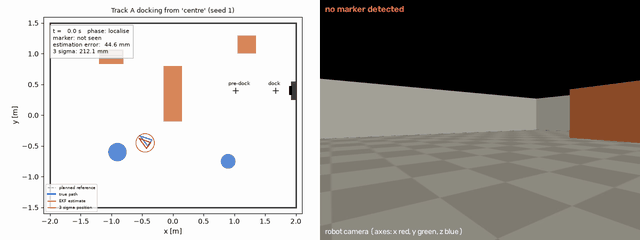

Full video of this run: `results/demo/west_south/demo.mp4`; a random room: `results/random_rooms/seed_3/demo.mp4`.

## Results at a glance

| Test | Runs | Docked | Docking position error |
|---|---|---|---|
| Random rooms, nominal (seeds 0 to 29) | 30 | 30 (95 percent Wilson interval 89 to 100 percent) | median 2.4 mm, max 9.2 mm |
| Robustness: nominal plus 10 disturbance and noise conditions, 20 rooms each (seeds 300 to 319) | 219 valid (1 invalid placement) | 219 | max 7.8 mm |
| Limit tests: station 0.35, 0.5 and 0.7 m from the given position (robot assumes within 0.20 m) | 60 | 60 | max 6.4 mm |
| Fixed demo room, three start points | 3 | 3 | 1.8 to 2.6 mm |

Docking success means the TRUE final pose is within 30 mm along the approach, 20 mm sideways and 5 degrees of the dock
pose (our assumption for a charging dock with spring contacts). None of the 447 valid robustness and trade-off runs touched
an obstacle or a wall (counted from MuJoCo contacts; the nominal batch and the demo were run before contacts were logged).

## Contents

1. [Quick start](#quick-start)
2. [Where everything is](#where-everything-is)
3. [How the system works](#how-the-system-works)
4. [Frames](#frames)
5. [Modelling](#1-modelling)
6. [Sensing and calibration](#2-sensing-and-calibration)
7. [Estimation](#3-estimation)
8. [Control, planning and visual servoing](#4-control-planning-and-visual-servoing)
9. [Integration and robustness](#5-integration-and-robustness)
10. [Trade-offs](#6-trade-offs)
11. [Failures found and how they were diagnosed](#failures-found-and-how-they-were-diagnosed)
12. [Known limitations](#known-limitations)
13. [Reproducing every number](#reproducing-every-number)
14. [Contribution statement, acknowledgements, Generative AI declaration](#contribution-statement)

## Quick start

```
python -m venv .venv && source .venv/bin/activate
pip install -r requirements.txt

mjpython commands/watch_live.py --random           # watch a new random room live in the MuJoCo viewer (macOS)
python commands/watch_live.py --random             # the same on Linux
python commands/run_random_rooms.py --seed 3       # random room 3: video, photos, plots, serial-monitor printout
python commands/run_demo.py                        # the fixed demo room from its three start points
```

`watch_live.py --random 7` replays room 7; `--start west_north` uses the fixed demo room. In the viewer, Reset (or
Backspace) restarts the whole run. Tested on macOS (Apple silicon) with Python 3.12 and MuJoCo 3.15.0 using MuJoCo's
default rendering backend. On Linux without a display, set `MUJOCO_GL=egl` (or `osmesa`) first; the Linux backends have
not been tested.

## Where everything is

```
robot_code/                EVERYTHING THAT RUNS ON THE ROBOT (it never sees the true position)
  robot_brain.py           the mission: what the robot does every 0.1 s (phases below)
  unicycle_model.py        motion model, linearisation, discretisation, controllability, observability
  lqr_controller.py        LQR tracker (Bryson weights, Riccati gain) and command slew limiter
  kalman_filter.py         the EKF: odometry predict, LiDAR fix update, camera marker update, gate
  lidar.py                 LiDAR position fix from the walls, occupancy map of the obstacles, safety stop
  vision.py                camera intrinsics, ArUco detection, marker pose in the robot frame, measurement noise
  docking.py               visual servoing into the station (marker frame), stop rule, marker search
  path_planning.py         A* on the LiDAR map, smoothing, speed profile, reference trajectory
  room_map.py              the room: walls, station and marker, start and end points
  random_room.py           random rooms with the no-clash rules
  simulator.py             MuJoCo: wheels, odometry, LiDAR ray casting, camera rendering, building the room
  data_types.py            the messages the parts pass to each other

experiments/               RUNS THE ROBOT AND SCORES IT AGAINST THE TRUTH
  run_simulation.py        one full run in MuJoCo, with all the disturbance options
  true_position.py         the only place the true position is read
  calibrate_camera.py, camera_noise_while_driving.py, calibrate_wheels.py, lidar_fix_accuracy.py, tune_kalman_filter.py
                           measure the numbers in settings/
  robustness_trials.py, tradeoff_studies.py
                           section 5 and 6 below
  plots.py, video.py, photos.py, serial_monitor.py, scores.py
                           figures, video, photos, the serial-monitor printout, NEES and success intervals

commands/                  THE THINGS YOU RUN: watch_live.py, run_random_rooms.py, run_demo.py
settings/                  measured numbers the robot reads (camera noise, wheel calibration, filter tuning, LiDAR)
mujoco_files/              the patched ROBOTIS robot (robot.xml), the demo room, the open floor for calibration
downloaded_robot_model/    the untouched official ROBOTIS TurtleBot3 Burger model
results/                   demo runs, a random room, calibration, robustness and trade-off results
```

| Question | File and function |
|---|---|
| How does the robot move? | `unicycle_model.py`: `f_unicycle`; wheel speeds and odometry: `simulator.py`: `wheel_speeds`, `step` |
| State-space model, linearisation, discretisation | `unicycle_model.py`: `tracking_error`, `linearise`, `zoh`, `error_model` |
| Controllability and observability | `unicycle_model.py`: `ctrb`, `observability_matrix_ltv`, `H_marker_pose`, `H_wall_point`, `H_pose` |
| LQR (Q, R, gain) | `lqr_controller.py`: `bryson`, `dlqr`, `design_gain`, `LQRTracker.command` |
| EKF predict and updates | `kalman_filter.py`: `EKF.predict`, `EKF.update_lidar`, `EKF.update_marker` |
| LiDAR position fix | `lidar.py`: `wall_fix` |
| Collision detection and avoidance | `lidar.py`: `LidarMap.add_scan`, `path_blocked`, `front_blocked`; `robot_brain.py`: `_lidar_replan_needed` |
| Camera model, frames, marker pose | `vision.py`: `intrinsics`, `ArucoDetector.detect`, `to_base_frame`, `MarkerSensor.measure` |
| Visual servoing | `docking.py`: `marker_frame_prior`, `docking_reference`, `should_stop`; `robot_brain.py`: phases LOOK, SERVO |
| Where do Q and R come from? | section 3 below and the scripts in `experiments/` that write `settings/` |

## How the system works

**The task.** Each run gets a start point at the west end of the room (y uniform along the end wall, heading within
45 degrees of east) and a charging station on the east wall. The robot is told the start point (its EKF prior) and a
station position `dock_hint_y`; the true station is anywhere within 0.20 m of it. The obstacles are not told to the
robot. In a random room the start, the station, its error and 3 to 5 obstacles are all drawn from the seed.

Every 0.1 s (`robot_code/robot_brain.py`):

```
wheel encoders --> odometry (v, omega) --+------------------------------+
                                         v                              v
LiDAR scan (5 Hz) --> wall matching --> NAVIGATION EKF (room frame)    DOCKING EKF (marker frame, only at the end)
       |                                 | estimate + covariance         ^           | pose relative to the marker
       +--> occupancy map, safety stop   |                               |           |
                   |                     v                               |           v
                   +--> A* on the LiDAR map --> reference --> LQR <------|------- docking reference (marker frame)
                                                               |         |
camera image --> ArUco detection --> marker pose ---------------|---------+   (camera used only in LOOK and SERVO)
                                                               v
                               (v, omega) --> slew limit --> wheel motors --> MuJoCo, 0.1 s
```

Phases:

1. **Localise.** Hold still until the navigation EKF has accepted a LiDAR position fix (the first scan, 0.2 s, unless the
   start is placed unusually far off).
2. **Plan.** A* from the estimate to the end point, 0.90 m in front of the given station position, on the LiDAR map
   (walls plus the obstacles seen so far; unseen cells count as free).
3. **Track.** LQR tracking of the path on the navigation estimate. Replan when the LiDAR shows an obstacle on the rest
   of the path, when the LiDAR safety stop triggers (anything within 0.205 m ahead), or when the estimated tracking error
   exceeds 0.25 m or 35 degrees.
4. **Look.** At the end point, turn to face the given station position, switch the camera on, start the docking EKF and
   wait for three accepted marker measurements (search by turning if the marker is not in view).
5. **Servo.** Visual servoing: the docking reference is built in the marker frame from the docking EKF estimate and
   tracked by the same LQR; stop when the estimated distance to the dock reaches zero. If no marker measurement is
   accepted for 3 s, go back to Look.

## Frames

```
W  room (MuJoCo world), z up. Walls at x = +-2.0 m, y = +-1.5 m.
|  (x, y, theta)  <- estimated by the navigation EKF
B  robot base: origin on the floor under the wheel axle centre, x forward, y left, z up
|---- L  LiDAR (LDS-01):  t = (-0.032, 0, 0.182) m, same orientation as B. Beam angle a, range r:
|                          point in B = (-0.032 + r cos a, r sin a)
|---- C  camera (MuJoCo convention: x right, y up, looking along -z): t = (0.056, 0, 0.110) m,
         R_BC = [[0, 0, -1], [-1, 0, 0], [0, 1, 0]]  (looks along +x of B)
         |
         C_cv  OpenCV camera frame (x right, y down, z forward):  R_C,Ccv = diag(1, -1, -1)
         |  solvePnP (IPPE_SQUARE)
         M_cv  OpenCV marker frame (x right, y up, z out of the face)
         |  x_M = z_cv, y_M = x_cv, z_M = y_cv
M  marker frame: origin at the marker centre, x out of the face (into the room), z up.
   In W: (1.916, dock_y, pi). dock_y is NOT known to the robot; the docking EKF estimates B in M directly.
   Dock pose in M: (0.25, 0, pi), the same in every room.
```

The camera measurement is projected to the plane as `z = (x_M, y_M, yaw_M)`: the marker position and the yaw of its
normal in B (`vision.py`: `to_base_frame`). The LiDAR fix is `z = (x, y, theta)` of B in W.

## 1. Modelling

### The platform

The robot is the official ROBOTIS TurtleBot3 Burger MuJoCo model (`downloaded_robot_model/`, Apache 2.0, unmodified),
with a patched copy in `mujoco_files/robot.xml`. Wheel radius 0.033 m, wheel separation 0.16 m and the wheel speed limit
of 6.67 rad/s are read from the model at run time. Physics runs at 2 ms, the control period is 0.1 s.

Driven as shipped, the model did not follow velocity commands. Three faults were found, and each masked the others:

1. The chassis collision mesh is used through its convex hull, which reaches below the caster, so the chassis dragged
   on the floor. Collision bitmasks now keep it off the floor; it still hits walls and obstacles.
2. The caster is meant to be frictionless, but MuJoCo uses the larger friction of two touching surfaces unless a
   priority is set. The caster now has priority.
3. The wheel servo gain (kv = 0.1) against the joint friction (0.1 N m) left a steady wheel speed error of 1 rad/s. The
   gain is now 3 (steady error 0.033 rad/s) with a 1.4 N m torque limit (the Dynamixel XL430 stall torque, an
   assumption).

| Test (0.1 s command period) | As shipped | Patched |
|---|---|---|
| 0.1 m/s for 3 s: distance moved / commanded | 0.39 | 0.99 |
| 1 rad/s turn in place: rotation / commanded | 0.29 | 0.98 |
| Arc at 0.15 m/s, 0.5 rad/s: true heading change / encoder heading change | 0.41 | 0.99 |

The ROBOTIS Burger model has no camera; a forward camera is added at the position in the frame diagram (an assumption).
LiDAR beams are cast from the ROBOTIS LDS-01 mount. Robot radius 0.105 m, from the collision meshes.

### Motion model

State `x = [x, y, theta]` (pose of B in W), input `u = [v, omega]`:

```
dx/dt = v cos(theta)      dy/dt = v sin(theta)      dtheta/dt = omega
wheel speeds:  w_right = (v + omega L / 2) / r      w_left = (v - omega L / 2) / r
odometry:      v = r (dphi_R + dphi_L) / (2 T)      omega = r (dphi_R - dphi_L) / (L T)
```

Over one period the unicycle is integrated exactly along an arc (`f_unicycle`); `F_unicycle` and `G_unicycle` are its
Jacobians with respect to the state and the input (used by the EKF).

### Tracking-error model, linearisation and discretisation

The error between the reference pose and the robot, in the robot frame (Kanayama form):

```
[e_x, e_y] = R(theta)^T ([x_r, y_r] - [x, y]),   e_theta = wrap(theta_r - theta)
de_x/dt = omega e_y - v + v_r cos(e_theta)
de_y/dt = -omega e_x + v_r sin(e_theta)
de_theta/dt = omega_r - omega
```

With `u = u_ref + du`, `e = 0` is an equilibrium. Linearised there and discretised exactly by zero-order hold:

```
A = [[0, w_r, 0], [-w_r, 0, v_r], [0, 0, 0]]      B = [[-1, 0], [0, 0], [0, -1]]      A_d = e^(A T), B_d by ZOH
```

### Controllability and observability

| Property | Rank | Meaning |
|---|---|---|
| Controllability, moving reference (v_r = 0.15 m/s) | 3 | all tracking errors can be corrected |
| Controllability, standstill reference (v_r = 0, w_r = 0) | 2 | the sideways error cannot be corrected (no sideways motion), so references never slow to zero; the stop rule ends the motion |
| Observability, odometry only | 0 | no absolute information: the estimate drifts |
| Observability, LiDAR points on one wall | 2 | the position along the wall is unobservable |
| Observability, LiDAR points on two walls that are not parallel (any room corner in view) | 3 | the whole pose is observable from one scan; `wall_fix` requires this |
| Observability, range and bearing to one marker | 2 | rotating the robot about the marker is invisible |
| Observability, full marker pose (position and yaw) | 3 | the whole pose relative to the marker is observable from one detection, so the docking EKF uses the marker pose |

## 2. Sensing and calibration

### Camera

640 x 480 pixels, vertical field of view 60 degrees, no distortion, so the intrinsics follow exactly:
`fx = fy = 240 / tan(30 deg) = 415.7 px`, `cx = 319.5`, `cy = 239.5` (`vision.py`: `intrinsics`). Horizontal field of
view 75.2 degrees. Chain: ArUco detection (DICT_4X4_50, id 0, 0.15 m marker, sub-pixel corners), `solvePnP` with
`SOLVEPNP_IPPE_SQUARE`, then the frame chain above. A square marker seen from far away has two poses that fit almost
equally well; when the second solution's reprojection error is within 3 times the first, both are passed on and the EKF
uses the one closer to its prediction.

### Marker calibration (`experiments/calibrate_camera.py`)

The robot is placed at about 2600 random poses (distance 0.18 to 3.6 m, viewing angle up to 75 degrees) and the measured
marker pose is compared with the truth. The measured distance was biased long, growing with distance; the bias is
fitted as `e_r = k r^2` (`k = 0.0063 per m`) on one sweep and checked on a second, independent sweep:

| Distance | Mean x error before correction | after | x std | y std | yaw std | Pose flips |
|---|---|---|---|---|---|---|
| 0.15 to 0.5 m | 0.3 mm | -0.3 mm | 0.4 mm | 0.2 mm | 0.11 deg | 0 |
| 0.5 to 1.0 m | 1.7 mm | -1.4 mm | 1.3 mm | 0.7 mm | 0.62 deg | 0 |
| 1.0 to 1.5 m | 6.6 mm | -2.1 mm | 4.8 mm | 1.8 mm | 0.96 deg | 0 |
| 1.5 to 2.0 m | 15.4 mm | -1.6 mm | 13.8 mm | 4.9 mm | 1.66 deg | 16 |

The visual servoing starts 0.9 m from the marker and ends at 0.2 m, so only the first two rows matter now: the camera
is used only where it is accurate and pose flips were never seen.

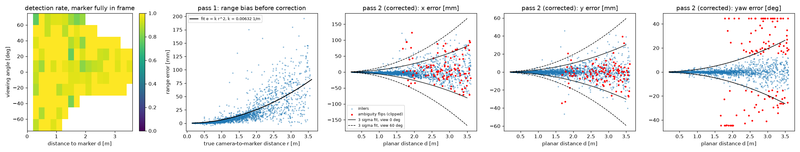

Measurement noise model, fitted by maximum likelihood (empirical, `d` distance, `a` viewing angle), with floors of 5 mm
and 0.5 degrees (an assumption for a real camera's pixel noise, which a noise-free renderer cannot show):

```
sigma_i(d, a) = sqrt(c0^2 + (c1 d^2)^2) (1 + c2 |a|)
x:   c0 = 0.00007 m, c1 = 0.0022 1/m, c2 = 1.02
y:   c0 = 0.0000 m,  c1 = 0.0008 1/m, c2 = 0.92
yaw: c0 = 0.0015 rad, c1 = 0.0125 rad/m^2, c2 = 0
```

**In motion** (`camera_noise_while_driving.py`, 15 random rooms, 1333 measurements during the visual servoing, no pose
flips): position errors stay well inside the model (normalised standard deviation 0.20 in x and 0.07 in y, because of
the 5 mm floor), but the yaw error is 2.41 times the static model (1.19 below 0.5 m, 3.13 between 0.5 and 1.0 m): the
body rocks while it moves. The yaw standard deviation is multiplied by 2.41.

### Odometry calibration (`experiments/calibrate_wheels.py`)

28 manoeuvres (straight lines, arcs of both signs, turns in place) compared with the truth. Fitted scales: `v x 0.997`,
`omega x 0.992`. The remaining one-step residual gives the extra process noise in section 3.

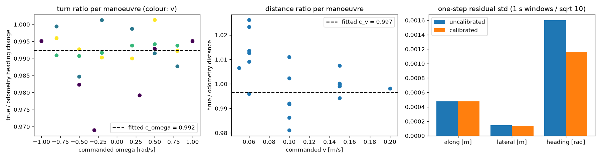

### LiDAR

ROBOTIS LDS-01 specification (`settings/lidar_spec.json`): 360 beams, 5 Hz, 0.12 to 3.5 m, noise 15 mm below 0.5 m and
5 percent of the range above (treated as one standard deviation). The LiDAR is used three ways (`robot_code/lidar.py`):

**Position fix (wall matching).** Every scan point is moved into the room with the predicted pose; points within 0.15 m
of a wall are matched to it, everything else (obstacles, the station) is ignored, and the stretch of the east wall
within 0.40 m of the given station position is skipped. For a point `p_B` on a wall with normal `n` at distance `d`, the
residual is `r = n . (R(theta) p_B + t) - d`. Gauss-Newton (4 iterations) on the weighted residuals, Jacobian row
`[n_x, n_y, n . dR/dtheta p_B]`, weight `1 / sigma^2` with `sigma` the datasheet noise of that beam, gives
`z = (x, y, theta)` with `R = (J^T W J)^-1`. At least 10 points on an x wall and 10 on a y wall are required
(observability above). The random rooms keep every obstacle at least 0.40 m from the walls, so obstacle points are never
matched.

**Accuracy against the truth** (`experiments/lidar_fix_accuracy.py`, 607 scans from 4 random rooms):

| | x | y | heading |
|---|---|---|---|
| mean error | -0.4 mm | -0.9 mm | 0.02 deg |
| standard deviation of the error | 9.1 mm | 8.1 mm | 0.33 deg |
| standard deviation the fix predicts (median) | 7.0 mm | 6.9 mm | 0.36 deg |
| ratio true / predicted | 1.16 | 1.20 | 0.87 |

The fix is unbiased. Its least-squares covariance is about 1.2 times too small in position and slightly cautious in
heading; the scale of 1.25 chosen independently by the consistency tuning (section 3) matches this.

**Occupancy map (collision avoidance).** Log-odds grid, 5 cm cells: cells a beam passes through `-0.4`, the cell it ends
in `+0.85`, obstacle above `0.5`, clamped to `[-2, 3.5]`. Only the first 2.5 m of each beam is used (beyond that the
5 percent range error exceeds two cells), and hits within 0.20 m of a known wall are taken to be the wall. The map is
placed with the navigation EKF estimate. The planner inflates obstacles by the robot radius plus 0.075 m.

**Safety stop (collision detection).** If any return within +-35 degrees of straight ahead is closer than the robot
radius + 0.10 m to the robot centre, the robot stops and replans.

## 3. Estimation

One filter class (`robot_code/kalman_filter.py`, state `x = [x, y, theta]`), used twice:

| | Navigation EKF | Docking EKF |
|---|---|---|
| Frame | room W | marker M |
| Runs | the whole run | from the end point to the dock |
| Predict | calibrated wheel odometry | calibrated wheel odometry |
| Update | LiDAR fix, `h(x) = x`, `H = I` | marker pose, `h(x) = [R(theta)^T (m_xy - p), wrap(m_yaw - theta)]` with `m = 0` |
| Initial state | the start point, std 5 cm, 5 cm, 3 degrees | navigation estimate moved into M with the given station position, plus the station uncertainty along the wall (0.20 / sqrt(3) = 0.115 m std, uniform error) |

```
predict:  x+ = f(x, u_odom),   P+ = F P F^T + G Qu G^T + Qa
update:   nu = z - h(x) (yaw wrapped),   S = H P H^T + R,   K = P H^T S^-1,   Joseph form for P
gate:     use the measurement only if NIS = nu^T S^-1 nu < 11.34 (chi-square, 3 dof, 99 percent)
recovery: navigation EKF: 3 consecutive rejected LiDAR fixes that agree (within 3 cm, 2 deg) reset the estimate to the
          fix; docking EKF: 8 consecutive rejected marker measurements that agree reset it to the camera's pose
```

| Noise | Value | Where it comes from |
|---|---|---|
| Odometry `Qu` | 0.005 m/s, 0.01 rad/s | the simulator's odometry noise (an assumption) |
| Extra process noise `Qa` per step | 0.36 mm + 0.028 percent of distance; 0.98 mrad + 0.15 percent of turn, all x 5 | odometry calibration residuals; the x 5 from the earlier consistency tuning of the odometry model |
| LiDAR fix `R` | `(J^T W J)^-1` x 1.25^2 | least squares with the datasheet noise; scale from the tuning below |
| Camera `R` | the fitted model, yaw x 2.41 (in motion), all x 0.75^2 | camera calibration; scale from the tuning below |

**Consistency tuning** (`experiments/tune_kalman_filter.py`, 8 random rooms per setting, every run docked). A
consistent filter has mean NEES 3 (3 states) and about 1 percent of updates gated out at the 99 percent gate. Rule:
among the settings with at most 2 percent gated out, the pair whose two mean NEES are closest to 3.

| LiDAR R std x | Camera R std x | Navigation NEES | Docking NEES | LiDAR fixes gated out | Camera updates gated out |
|---|---|---|---|---|---|
| 1.0 | 1.0 | 3.72 | 2.60 | 0.3 percent | 0.1 percent |
| 1.0 | 0.5 | 3.76 | 3.08 | 0.3 percent | 7.6 percent |
| **1.25** | **0.75** | **2.66** | **3.37** | **0.1 percent** | **1.4 percent** |
| 1.25 | 0.5 | 2.72 | 3.17 | 0.1 percent | 5.7 percent |
| 1.5 | 0.75 | 2.15 | 2.71 | 0 percent | 1.7 percent |
| 2.0 | 1.0 | 1.43 | 2.80 | 0 percent | 0.3 percent |

Camera scale 0.5 gives a docking NEES near 3 but gates out 5.2 to 8.2 percent of the measurements (heavy tails the
Gaussian model does not capture), so it was excluded. Full table: `results/calibration/kalman_filter_tuning.json`.

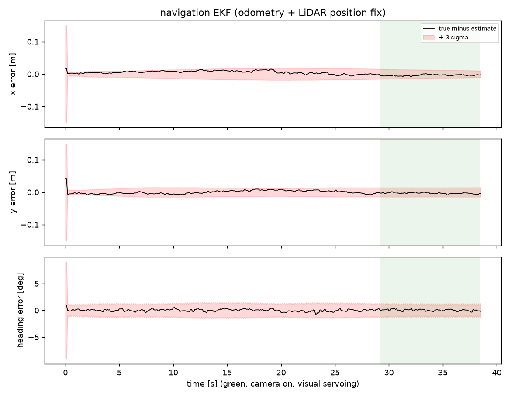
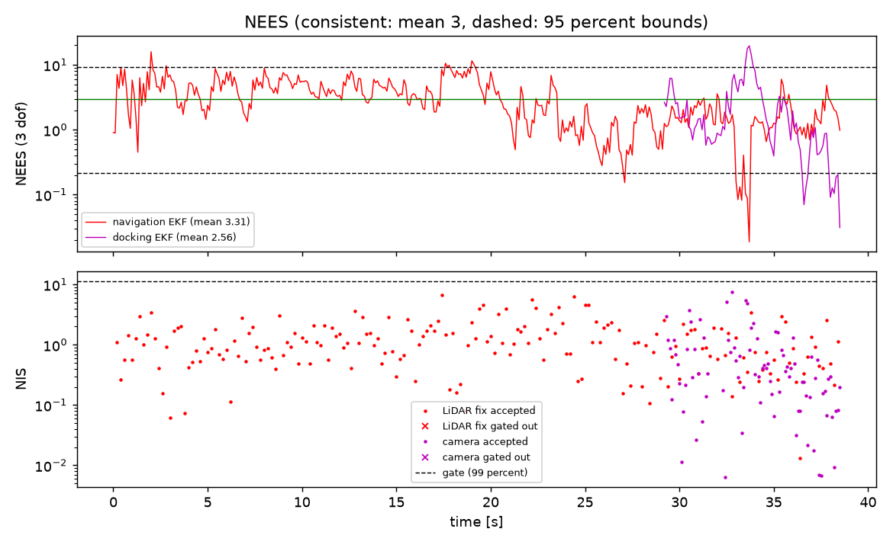

## 4. Control, planning and visual servoing

### LQR tracker (`robot_code/lqr_controller.py`)

Command = reference speeds (feedforward) + LQR feedback on the ESTIMATED tracking error, `u = u_ref - K e`. Weights by
Bryson's rule from the largest acceptable errors (5 cm, 5 cm, 5 degrees) and corrections (0.05 m/s, 0.5 rad/s):
`Q = diag(400, 400, 131.3)`, `R = diag(400, 4)`. The gain is solved from the discrete Riccati equation at every reference
sample (gain scheduling); the design speed is floored at 0.02 m/s because the model is not controllable at standstill.

| Operating point | Gain K (rows: v, omega) | Closed-loop eigenvalues | Time constants |
|---|---|---|---|
| Cruise, 0.15 m/s, straight | [[-0.95, 0, 0], [0, -7.44, -4.52]] | 0.905, 0.568, 0.974 | 1.0 s, 0.18 s, 3.8 s |
| Arc, 0.15 m/s, 0.5 rad/s | [[-1.14, 0.39, 0.01], [1.08, -4.40, -4.44]] | 0.934 +- 0.039j, 0.568 | 1.5 s, 1.5 s, 0.18 s |
| Docking, 0.06 m/s, straight | [[-0.95, 0, 0], [0, -7.50, -4.40]] | 0.905, 0.568, 0.990 | 1.0 s, 0.18 s, 9.6 s |

All eigenvalues are inside the unit circle. Limits: 0.22 m/s and 2.75 rad/s (the ROBOTIS wheel limit); the slew limiter
caps changes at 0.5 m/s^2 and 3 rad/s^2. Section 6 measures what changing R does.

### Path planning (`robot_code/path_planning.py`)

A* on the 5 cm LiDAR occupancy grid, obstacles inflated by 0.105 + 0.075 m; line-of-sight shortcuts; corners replaced
by circular arcs (drivable by a differential drive); a speed profile (0.15 m/s cruise, 0.8 rad/s on arcs, 0.15 m/s^2)
turns it into a time-indexed reference integrated with the unicycle model, so pose and speeds agree.

### Visual servoing (`robot_code/docking.py`)

Position-based visual servoing in the marker frame. From the docking EKF estimate (the robot pose relative to the
marker, driven by the camera), a cubic Bezier curve joins the marker's normal line 0.30 m before the dock pose, then a
straight approach at 0.06 m/s to the dock (0.25 m from the marker face) and 0.30 m beyond. The same LQR tracks it on the
docking EKF estimate, so the command comes from what the camera sees. The reference never slows to zero
(controllability); the robot stops when the estimated distance to the dock falls below half a control step of travel.
The station's position in the room is never needed.

## 5. Integration and robustness

### Fixed demo room (`python commands/run_demo.py`, seed 1)

The station is at y = 0.40 m; the robot is told 0.25 m (0.15 m off).

| Start point | Result | Error along | Error sideways | Heading error | Time | Navigation NEES | Docking NEES |
|---|---|---|---|---|---|---|---|
| west_south | docked | 2.1 mm | -0.4 mm | -0.23 deg | 32.6 s | 3.21 | 1.87 |
| west_centre | docked | 2.2 mm | -1.3 mm | -0.02 deg | 29.5 s | 2.80 | 1.36 |
| west_north | docked | 0.8 mm | -1.6 mm | 0.12 deg | 38.5 s | 3.31 | 2.56 |

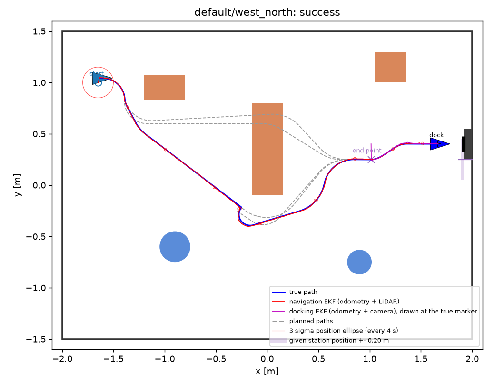

In this run the first plan goes north of the long block, through cells the LiDAR has not seen yet. As soon as the LiDAR
shows the block, the rest of the path is blocked and the robot replans around the south side. The 44.6 mm "max
estimation error" of these runs is the hand-placement error of the start, before the first LiDAR fix; the robot does not
move during that time.

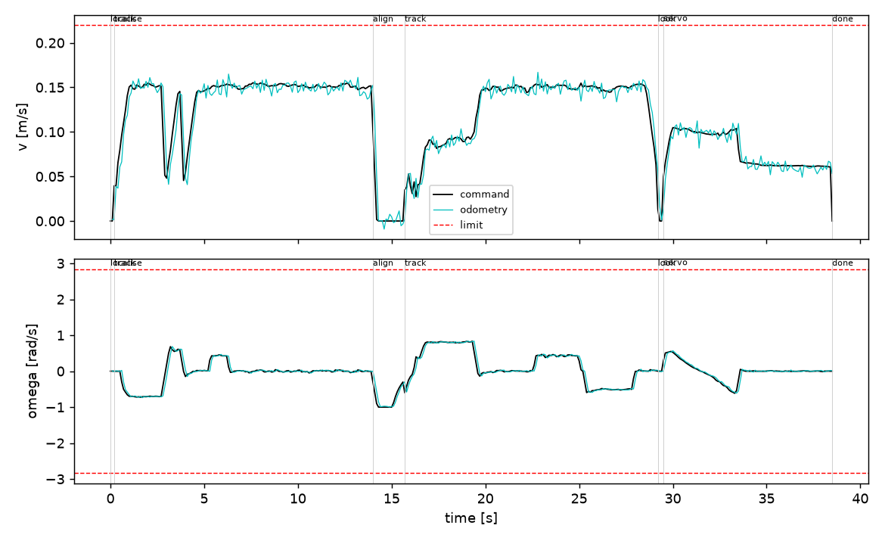

### Random rooms (`robot_code/random_room.py`)

Each seed draws a start point, a station and its error, and 3 to 5 obstacles (rotated boxes and cylinders). A room is
redrawn until every rule holds: obstacles at least 0.40 m apart and from the walls (the robot needs
2 x (0.105 + 0.075) = 0.36 m to pass), no obstacle in the docking corridor in front of the station, the start clear of
obstacles, a path exists on the full map, and MuJoCo reports no contact once the robot is placed.
`python commands/run_random_rooms.py --seed N` saves the room with its rules drawn, robot camera photos, a video and
`monitor.txt`, a serial-monitor printout of what the robot calculates twice a second (EKF estimate and uncertainty,
commands, LiDAR fix NIS, safety-stop distance, obstacle cells, and at the end the marker measurement and the docking
estimate).

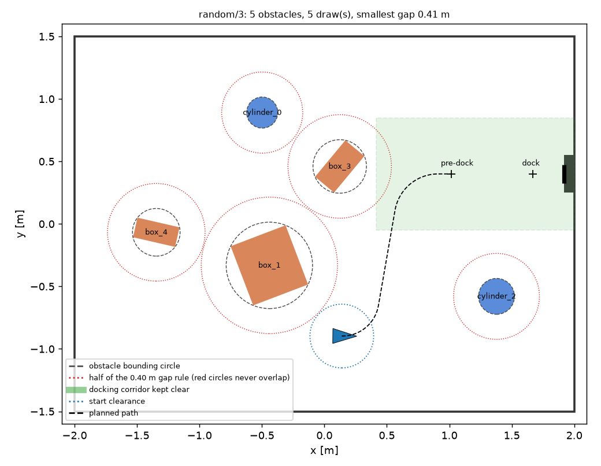
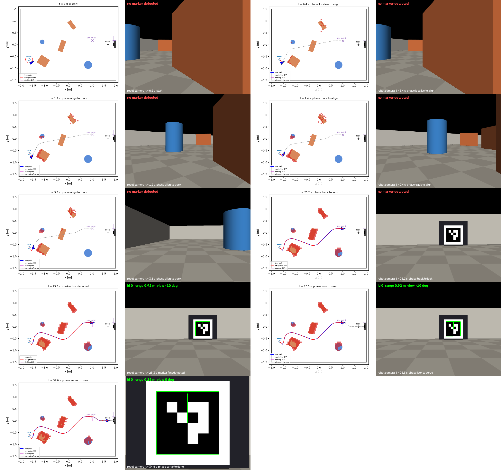

**Nominal batch, seeds 0 to 29:** 30 of 30 docked (95 percent Wilson interval 89 to 100 percent); docking position
error median 2.4 mm, max 9.2 mm, heading at most 0.86 degrees; the true station was -0.199 to +0.195 m from the given
position; mean navigation NEES 3.11; LiDAR fixes gated out 0.15 percent, camera updates 1.5 percent.

### Robustness trials (`experiments/robustness_trials.py`)

Every condition runs on the same 20 rooms (seeds 300 to 319, never used for calibration or tuning). Each condition
changes the simulated world or the sensor stream only; the robot's software and settings are unchanged and do not know
about it.

| Condition | What changes | Docked | Docking error median / max | Max heading error | Time (median) | Estimation error at end of trip (median) | Navigation NEES | Docking NEES |
|---|---|---|---|---|---|---|---|---|
| nominal | nominal | 20 of 20 | 2.3 / 5.3 mm | 0.47 deg | 29.8 s | 5.6 mm | 2.89 | 2.57 |
| odometry noise x2 | encoder velocity noise std x 2 | 20 of 20 | 2.2 / 4.2 mm | 0.52 deg | 29.8 s | 5.9 mm | 3.04 | 2.91 |
| odometry noise x4 | encoder velocity noise std x 4 | 20 of 20 | 2.5 / 5.1 mm | 0.57 deg | 29.8 s | 7.5 mm | 3.85 | 3.85 |
| wheel radius +-2 percent | left wheel 2 percent larger, right 2 percent smaller than the software believes | 20 of 20 | 3.1 / 7.8 mm | 0.52 deg | 29.5 s | 6.2 mm | 3.65 | 3.34 |
| floor friction x0.3 | wheel and floor friction x 0.3 (slip) | 20 of 20 | 2.5 / 5.7 mm | 0.45 deg | 30.0 s | 6.8 mm | 2.8 | 3.52 |
| push while navigating | kick at t = 8 s: +0.15 m/s, +1.0 rad/s | 20 of 20 | 2.0 / 5.7 mm | 0.47 deg | 29.8 s | 5.6 mm | 2.97 | 2.73 |
| push while docking | kick 3 s into the servoing: +0.10 m/s, +0.8 rad/s | 20 of 20 | 2.3 / 5.3 mm | 0.47 deg | 29.8 s | 5.6 mm | 2.9 | 2.43 |
| camera frames lost 50 percent | each camera frame dropped with probability 0.5 | 20 of 20 | 2.5 / 6.8 mm | 0.64 deg | 30.1 s | 5.6 mm | 2.9 | 2.1 |
| LiDAR noise x2 | LiDAR range noise x 2 (the robot still assumes the datasheet) | 20 of 20 | 3.3 / 6.7 mm | 0.62 deg | 31.4 s | 23.4 mm | 35.04 | 2.63 |
| start 3x further off | start placement error x 3 the prior the robot assumes | 19 of 19 (1 invalid) | 2.4 / 4.4 mm | 0.53 deg | 30.6 s | 5.8 mm | 3.7 | 3.77 |
| combined | odometry x 2, wheels +-1 percent, friction x 0.5, LiDAR noise x 1.5, 30 percent frames lost | 20 of 20 | 2.7 / 4.5 mm | 0.78 deg | 30.2 s | 13.8 mm | 13.2 | 3.73 |
| station 0.35 m off (limit test) | true station 0.35 m from the given position (robot assumes within 0.20 m) | 20 of 20 | 2.6 / 6.3 mm | 0.64 deg | 33.0 s | 13.0 mm | 46.48 | 2.52 |
| station 0.5 m off (limit test) | 0.5 m off | 20 of 20 | 2.8 / 5.4 mm | 0.47 deg | 36.3 s | 24.2 mm | 125.37 | 5.6 |
| station 0.7 m off (limit test) | 0.7 m off (outside the first camera view) | 20 of 20 | 3.6 / 6.4 mm | 2.47 deg | 39.7 s | 23.6 mm | 109.45 | 8.32 |

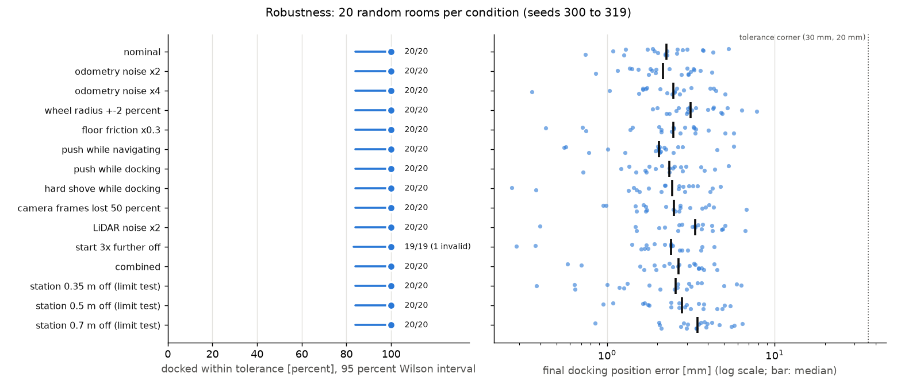

Every valid run docked, and no run touched an obstacle or a wall. The one invalid trial (start 3x further off,
seed 316) never started: the larger placement error put the robot inside the west wall, which the set-up check rejects.
What the disturbances do change is the estimation, and that is where the design shows how it works:

- **Odometry noise, wheel radius error, slip and pushes** barely move the docking error. The LiDAR fix bounds the
  odometry drift every 0.2 s: the estimation error at the end of the trip only grows from 5.6 mm to 7.5 mm with four
  times the odometry noise. The navigation NEES rises to 3.65 to 3.85 with the wheel error and x 4 noise, because the
  process noise was tuned for the nominal odometry.
- **Half the camera frames lost:** the docking EKF predicts on odometry between frames; accuracy is unchanged.
- **LiDAR noise x 2** makes the navigation EKF inconsistent (NEES 35): the robot still assumes the datasheet noise, so
  its LiDAR R is four times too small, and its estimate at the end of the trip is 23 mm off instead of 6 mm. Docking is
  unaffected (median 3.3 mm): the visual servoing works in the marker frame from the camera, so the docking accuracy
  does not depend on the navigation estimate. This separation is the main reason the system is robust. The combined
  condition (NEES 13.2) is inconsistent for the same reason.
- **Limit tests.** With the station 0.35, 0.5 and even 0.7 m from the given position the robot still docked 60 of 60:
  at 0.7 m the marker is outside the first view and the search turn finds it, at the cost of time (39.7 s against
  29.8 s) and a larger heading error (up to 2.5 degrees). The docking EKF becomes overconfident (NEES 5.6 and 8.3)
  because its prior assumes the station within 0.20 m. The navigation EKF breaks down (NEES 46 to 125): the LiDAR fix
  skips the east wall only within 0.40 m of the GIVEN station position, so a station further away has its front face,
  8 cm in front of the wall, matched as the wall. Checked directly on room 301 with the station 0.5 m off: the fix's
  x error had a mean of +26 mm with the skipped band where it is, and +1.7 mm with the band moved to the true station.

## 6. Trade-offs

`experiments/tradeoff_studies.py`, 12 random rooms per setting (seeds 400 to 411). Every setting docked 12 of 12 except
where stated.

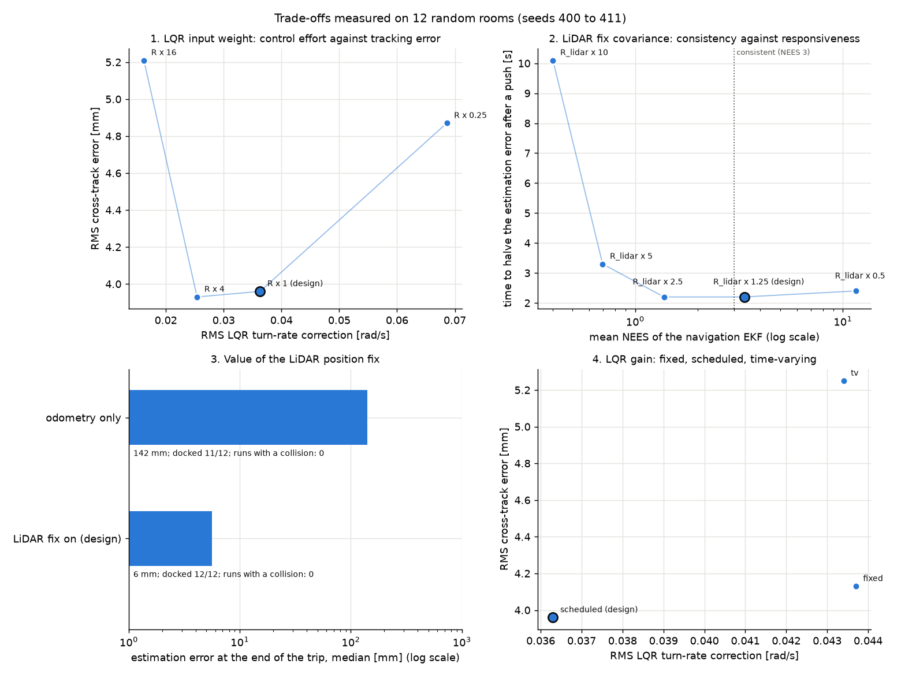

**1. LQR input weight R: control effort against tracking error.**

| R x | RMS LQR speed correction | RMS LQR turn-rate correction | RMS turn command rate | RMS cross-track error (true) | Median docking error |
|---|---|---|---|---|---|
| 0.25 | 4.4 mm/s | 0.069 rad/s | 0.68 rad/s^2 | 4.9 mm | 3.6 mm |
| **1 (design)** | **2.8 mm/s** | **0.036 rad/s** | **0.63 rad/s^2** | **4.0 mm** | **2.3 mm** |
| 4 | 2.0 mm/s | 0.025 rad/s | 0.59 rad/s^2 | 3.9 mm | 2.4 mm |
| 16 | 1.5 mm/s | 0.016 rad/s | 0.56 rad/s^2 | 5.2 mm | 2.8 mm |

Halving the feedback (R x 4) costs nothing measurable; quartering it again (x 16) lets the true tracking error grow.
Doubling the feedback (R x 0.25) makes tracking *worse*, not better: the true tracking error has a floor set by the
estimation error (navigation EKF RMS error about 10 mm), and a stiffer controller chases the estimate's noise. Between
R x 1 and x 4 the differences are within the run-to-run spread of 12 rooms, so x 1 is kept.

**2. LiDAR fix covariance: estimator consistency against responsiveness.** A push at t = 8 s (+0.15 m/s, +1.0 rad/s)
gives the filter a sudden error to correct.

| LiDAR R std x | Mean navigation NEES | LiDAR fixes gated out | Peak extra error after the push | Time to halve it | RMS cross-track error (true) |
|---|---|---|---|---|---|
| 0.5 | 11.5 (overconfident) | 12.9 percent | 12.5 mm | 2.4 s | 4.4 mm |
| **1.25 (design)** | **3.36** | **0.16 percent** | **6.6 mm** | **2.2 s** | **4.0 mm** |
| 2.5 | 1.38 | 0.16 percent | 5.3 mm | 2.2 s | 5.5 mm |
| 5 | 0.70 | 0 | 5.1 mm | 3.3 s | 6.5 mm |
| 10 | 0.40 (underconfident) | 0 | 3.4 mm | 10.1 s | 9.7 mm |

An overconfident filter (x 0.5) gates out 12.9 percent of good LiDAR fixes (the innovation looks too large for its small
covariance), so after the push its error peaks highest. An underconfident one (x 10) leans on the odometry and takes 10 s to recover;
the lagging estimate also more than doubles the true tracking error. The consistent setting (x 1.25) recovers as fast
as any (x 2.5 ties on recovery but tracks worse) while keeping NEES near 3. The push
itself causes only a few millimetres of estimation error because the wheels roll with it and the odometry sees most of
the motion.

**3. Value of the LiDAR position fix.** With the fix off, the navigation EKF runs on odometry alone (the LiDAR map and
safety stop still run, placed with the drifting estimate).

| | Median estimation error at the end of the trip | Mean RMS estimation error | RMS cross-track error (true) | Docked |
|---|---|---|---|---|
| **LiDAR fix on (design)** | **5.6 mm** | **9.7 mm** | **4.0 mm** | **12 of 12** |
| odometry only | 141.5 mm | 123.0 mm | 70.2 mm | 11 of 12 |

The camera at the end rescues 11 of the 12 odometry-only runs, because the docking EKF does not depend on the room
frame. The failure (seed 408) shows why the fix matters beyond the estimate: 1.6 s in, the estimate was already
150 mm and 7 degrees off (the start placement error is never corrected), the LiDAR map placed an obstacle about 15 cm
from its true position, next to the end point, and the planner found no path.

**4. LQR gain: fixed, scheduled or time-varying.**

| Gain | RMS LQR turn-rate correction | RMS cross-track error (true) | Median docking error |
|---|---|---|---|
| fixed (designed at 0.1 m/s, straight) | 0.044 rad/s | 4.1 mm | 1.6 mm |
| **scheduled on the reference (design)** | **0.036 rad/s** | **4.0 mm** | **2.3 mm** |
| finite-horizon time-varying | 0.043 rad/s | 5.3 mm | 4.8 mm |

The time-varying gain docks worst. Checked directly: on a docking reference its lateral gain at the stop point is -3.5
against -7.5 for the scheduled gain, because the horizon ends only about 5 s after the stop and the backward Riccati recursion
has not reached steady state there; the sideways error is corrected less in the final approach. Fixed and scheduled
gains perform alike on these paths (cruise speed varies little); scheduling is kept because it adapts the gain to the
slow docking speed and to arcs.

## Failures found and how they were diagnosed

| Failure | How it showed | Cause found | Fix |
|---|---|---|---|
| ROBOTIS model drove 39 percent of the commanded distance | drive tests against the truth | chassis hull dragging, caster friction rule, weak wheel servo | three model patches |
| Marker distance biased long (+62 mm at 3 to 3.6 m) | calibration sweep against the truth | detected edges sit a fraction of a pixel inside the true edges | `k r^2` correction, checked on an independent sweep |
| Marker invisible when docked | detection failed at close range | MuJoCo scales the near clip plane by the model size | fixed model extent, near clip 8 mm |
| Navigation EKF overconfident (NEES 8.6) | NEES against the truth | the first LiDAR fix weighted each point by its noise along the wall normal; measured against the truth, that covariance was 1.5 to 1.7 times too small, the plain range noise only 1.2 times | plain range noise, then consistency tuning (x 1.25) |
| Robot drove 3 s on a 154 mm wrong start estimate (seed 13) | estimation error trace | start placed 3 sigma off; the first LiDAR fixes were just outside the gate (NIS 11.5 to 12.7) | Localise phase (wait for an accepted fix) and the agreeing-fixes recovery |
| First automatic camera tuning gated out 5.7 percent of good measurements | gate rejection rate | NEES-only rule ignored heavy tails | rule now also caps rejections at 2 percent |
| Control-effort metric equal for every LQR weight | trade-off study | the metric was dominated by the planned speeds | logged and measured the LQR correction itself |
| Odometry-only run found no path (seed 408) | trade-off study | LiDAR map placed with a 150 mm wrong pose | shows why the LiDAR fix is part of the design |
| Time-varying LQR docked worst | trade-off study | finite horizon: lateral gain at the stop half the steady-state value | scheduled gain kept |

## Known limitations

- **The LiDAR fix relies on the given station position.** It skips the east wall within 0.40 m of it. If the true
  station is further away than assumed, the station face is matched as the wall and the navigation estimate is biased
  by about 26 mm in x (limit tests, section 5). Docking still succeeds because it does not use the room frame. A fix
  would be to also skip points that lie a station depth in front of the east wall.
- **The filters are only consistent for the noise they were tuned for.** With twice the LiDAR noise the navigation NEES
  is 35; the robot never adapts its noise model online.
- **The LiDAR fix needs a known rectangular room** and walls the obstacles do not hide: at least 10 points on two
  non-parallel walls. The random rooms keep obstacles 0.40 m from the walls; a cluttered room against the walls would
  need scan matching against a map instead of against four lines.
- **The docking EKF is conservative in position.** The 5 mm floor on the camera noise (kept for a real camera) is far
  above the simulated errors at close range (normalised std 0.2 and 0.07), so the docking NEES of the demo runs is 1.4
  to 2.6, below 3.
- **Simulation only.** The camera mounting, the odometry noise, the start prior, the servo gain and torque limit and the
  docking tolerances are our assumptions. Sensor noise is Gaussian and independent; a real LiDAR and camera have
  correlated errors and outliers that this simulation does not contain.
- **Small samples.** 20 rooms per robustness condition give a 95 percent Wilson lower bound of 84 percent for 20 of 20;
  the trade-off studies use 12 rooms, so differences of a fraction of a millimetre are not significant.

## Reproducing every number

```
python -m experiments.calibrate_camera              # settings/camera_noise.json (about 8 min, uses mujoco_files/room.xml)
python -m experiments.calibrate_wheels              # settings/wheel_calibration.json
python -m experiments.camera_noise_while_driving    # in-motion camera noise (dynamic_inflation)
python -m experiments.tune_kalman_filter            # settings/kalman_filter_tuning.json
python -m experiments.lidar_fix_accuracy            # results/calibration/lidar_fix_accuracy.json
python commands/run_demo.py                         # results/demo/
python commands/run_random_rooms.py --seed 0 --count 30 --quiet --no-video --no-photos
python -m experiments.robustness_trials             # results/robustness/
python -m experiments.tradeoff_studies              # results/tradeoffs/
```

Every run is seeded, so the same commands give the same results. The scripts take an optional number of parallel
workers (default 6).

## Contribution statement

| Member | Responsible for |
|---|---|
| Ahmed El Zarw | State-space model and LQR controller (`robot_code/unicycle_model.py`, `robot_code/lqr_controller.py`) |
| Jeremy | EKF fusing wheel odometry with the LiDAR position fix and the ArUco camera measurements (`robot_code/kalman_filter.py`) |
| Janith | ArUco detection and docking logic (`robot_code/vision.py`, `robot_code/docking.py`) |

As a team we:

- chose the Track A design and decided to use the official ROBOTIS TurtleBot3 Burger model;
- specified that the motion model, linearisation, discretisation, LQR and EKF follow the formulas from the weekly
  tutorials;
- tested the simulation in the live viewer, and found that the viewer's Reset button broke the run (the robot was
  moved without the estimator being told), which led to the fix;
- gave the feedback that led to the random rooms, the robot camera photos and the serial-monitor printout;
- passed on the tutor's feedback that led to the final design: a randomised start point at one end of the room, a
  randomised station at the other, the EKF and LiDAR for the trip, the LQR for control, and visual servoing only at
  the end.

## Acknowledgements

- TurtleBot3 Burger MuJoCo model and meshes: ROBOTIS, `robotis_mujoco_menagerie`, Apache License 2.0
  (`downloaded_robot_model/`). `mujoco_files/robot.xml` is a modified copy.
- LDS-01 LiDAR specification: ROBOTIS TurtleBot3 e-Manual (values in `settings/lidar_spec.json`).
- Linearisation, discretisation, LQR and EKF structure adapted from the weekly tutorials and from Ahmed El Zarw's
  41014 Assessment 3 work. The tracking-error model is the standard Kanayama form; the occupancy map uses the standard
  log-odds update.

## Generative AI declaration

Tool: Claude (Anthropic), used through the Claude chat interface and Claude Code.

Purpose: the team set the requirements, the design decisions and the order of work listed in the contribution
statement, directed the development and tested the results. Claude Code generated most of the code and documentation in
this repository under that direction. This includes the platform wrapper, the models and the LQR tracker; the room
scene, the camera rendering and the ArUco measurement pipeline with its calibration; the EKF with its LiDAR and camera
updates, the LiDAR position fix, occupancy map and safety stop; the planning and visual servoing; the odometry
calibration and filter tuning; the robot's decision logic; the random rooms, photos and serial-monitor printout; the
robustness trials and trade-off studies; the evaluation, demo and viewer commands; the project layout; and this README.
Claude Code also ran the diagnostics that found the issues listed above, including the three faults in the ROBOTIS
model.

Each team member is responsible for reviewing and understanding the parts credited to them in the contribution
statement.
