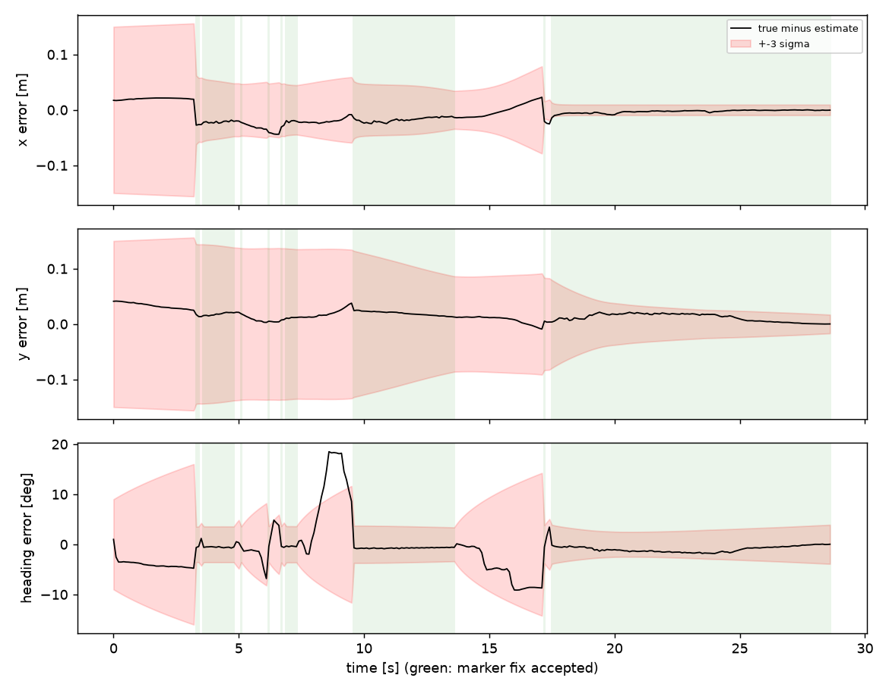
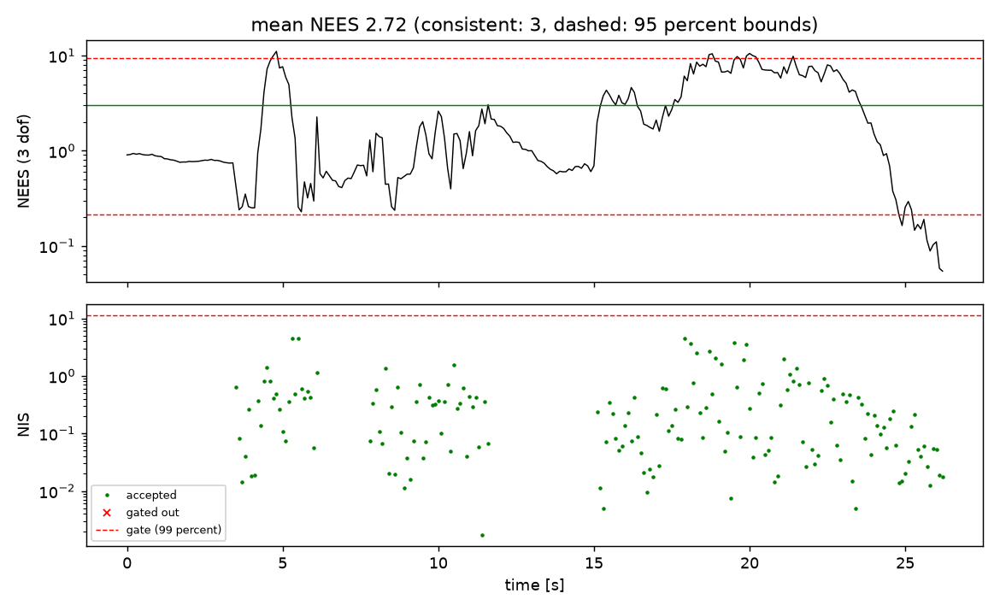
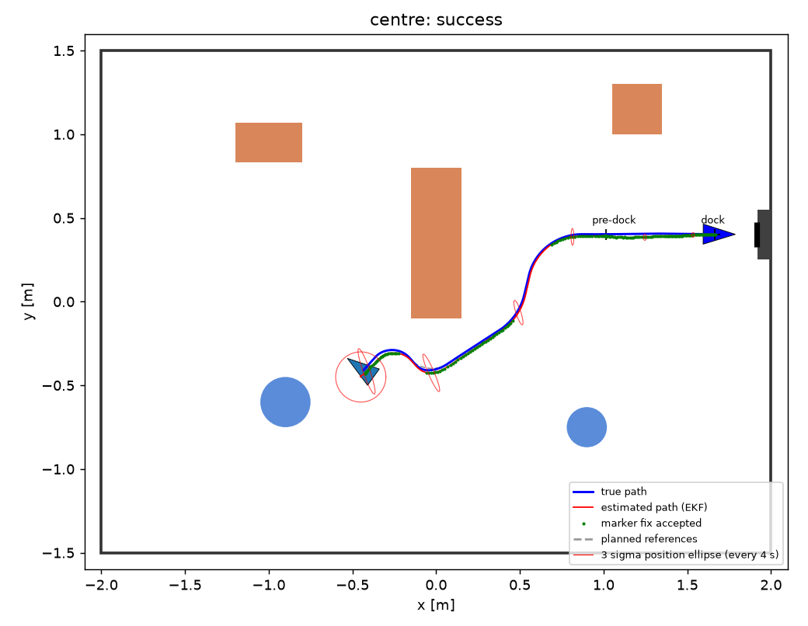
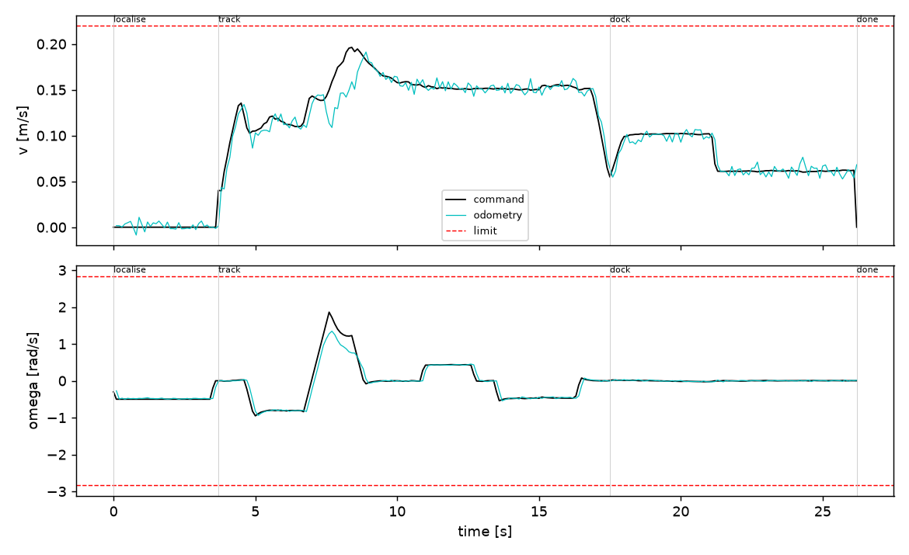
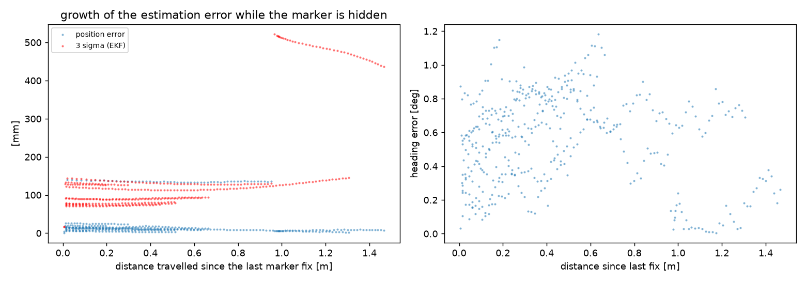

# 41014 Sensors and Control, Integrated Project, Track A

**Visual docking of a TurtleBot3 Burger in MuJoCo.** The official ROBOTIS TurtleBot3 Burger model localises itself from
an ArUco marker on a charging station, plans a path around the obstacles in a room, follows it with an LQR controller
that acts on an EKF estimate, and docks at the station.

**The controller never receives the true position.** Everything that runs on the robot is in `robot_code/`; the true
position is read only in `experiments/`, to score the results, and `tests/test_robot_never_sees_truth.py` fails if any
robot code touches it.


Full-length videos: `results/demo/<start pad>/demo.mp4` (seven runs) and `results/random_rooms/seed_3/demo.mp4`.

## Results at a glance

| Test | Runs | Docked | Docking position error |
|---|---|---|---|
| Fixed room, seven start pads (two without a view of the marker) | 7 | 7 | 3.0 to 11.5 mm |
| Random rooms, marker in view at the start (seeds 100 to 129) | 30 | 30 (95 percent interval 89 to 100 percent) | median 5.4 mm, max 15.5 mm |
| Random rooms, hidden starts allowed (seeds 200 to 229) | 30, of which 6 hidden | 30, including 6 of 6 hidden | median 6.1 mm, max 12.4 mm |

Docking success means the true final pose is within 3 cm along the approach, 2 cm laterally and 5 degrees of the dock
pose (our assumption for a charging dock with spring contacts).

## Contents

1. [Quick start](#quick-start)
2. [Where everything is](#where-everything-is)
3. [How the system works](#how-the-system-works)
4. [Modelling](#1-modelling)
5. [Sensing and calibration](#2-sensing-and-calibration)
6. [Estimation](#3-estimation)
7. [Control, planning and docking](#4-control-planning-and-docking)
8. [Integration and robustness](#5-integration-and-robustness)
9. [Failures found and how they were diagnosed](#failures-found-and-how-they-were-diagnosed)
10. [Known limitations](#known-limitations)
11. [Reproducing every number](#reproducing-every-number)
12. [Contribution statement, acknowledgements, Generative AI declaration](#contribution-statement)

## Quick start

```
python -m venv .venv && source .venv/bin/activate
pip install -r requirements.txt
python -m pytest -q                                  # 83 automatic checks

python commands/run_demo.py                          # five start pads, plots, video of the first
python commands/run_demo.py --hidden --video-all     # all seven start pads, a video for each
python commands/run_random_rooms.py                  # a new random room, with the serial-monitor printout
python commands/run_random_rooms.py --seed 3         # reproduce random room 3
python .venv/bin/mjpython commands/watch_live.py --random 3   # watch it live in the MuJoCo viewer (macOS)
python commands/watch_live.py --random 3                      # the same on Linux
```

Tested on macOS (Apple silicon) with Python 3.12 and MuJoCo 3.15.0 using MuJoCo's default rendering backend. On Linux
without a display, set `MUJOCO_GL=egl` (or `osmesa`) first; the Linux backends have not been tested. In the live viewer,
Reset (or Backspace) restarts the whole run from the start pad.

## Where everything is

```
robot_code/                  EVERYTHING THAT RUNS ON THE ROBOT (it never sees the true position)
  robot_brain.py             decides what to do every 0.1 s: find marker, plan, drive, dock
  data_types.py              the messages the parts pass to each other
  room/                      the map: room_map.py (the room the robot is given), random_room.py (random rooms)
  simulated_robot/           the TurtleBot3 in MuJoCo: simulator.py (wheels, odometry, LiDAR), camera.py,
                             mujoco_room.py (builds the room)
  movement_maths/            unicycle_model.py: how the robot moves, linearisation, controllability
  vision/                    marker_detection.py (find the ArUco marker), camera_maths.py, marker_noise.py
  localisation/              kalman_filter.py: "where am I?" (the EKF)
  path_planning/             astar_grid.py (A*), smooth_path.py, plan_path.py, reference_path.py
  controller/                lqr_controller.py (LQR), smooth_commands.py
  docking/                   docking.py: final approach and stop

experiments/                 RUNS THE ROBOT AND CHECKS IT AGAINST THE TRUTH
  run_simulation.py          one full run in MuJoCo
  true_position.py           the only place the true position is read
  scores.py                  errors, NEES, success-rate intervals
  calibration/               measures the numbers in settings/
  outputs/                   plots, video, photos, serial monitor

commands/                    THE THINGS YOU RUN: run_demo.py, run_random_rooms.py, watch_live.py, build_mujoco_files.py
settings/                    measured numbers the robot reads (camera noise, wheel calibration, filter tuning, LiDAR)
mujoco_files/                robot.xml, room.xml, open_floor.xml (built by commands/build_mujoco_files.py)
downloaded_robot_model/      the untouched official ROBOTIS TurtleBot3 Burger model
tests/                       automatic checks: python -m pytest -q
results/                     demo runs, random rooms, calibration figures
```

Each folder's `__init__.py` lists what is inside it.

| Question | File and function |
|---|---|
| How does the robot move (kinematics)? | `robot_code/movement_maths/unicycle_model.py`: `f_unicycle` |
| How are (v, omega) turned into wheel speeds, and wheel encoders into odometry? | `robot_code/simulated_robot/simulator.py`: `wheel_speeds`, `step` |
| Where is the physics simulated? | `robot_code/simulated_robot/simulator.py`: `step` (calls `mujoco.mj_step` 50 times per 0.1 s) |
| State-space model, linearisation, discretisation | `robot_code/movement_maths/unicycle_model.py`: `tracking_error`, `linearise`, `zoh` |
| Controllability and observability | `robot_code/movement_maths/unicycle_model.py`: `ctrb`, `observability_matrix_ltv`, `H_marker_pose`; checks in `tests/test_movement_maths.py` |
| LQR (Q, R, gain) | `robot_code/controller/lqr_controller.py`: `bryson`, `dlqr`, `design_gain`, `LQRTracker.command` |
| Open loop and closed loop | `robot_code/controller/lqr_controller.py`: `LQRTracker.command` (reference speeds plus feedback on the estimate) |
| EKF predict and update | `robot_code/localisation/kalman_filter.py`: `MarkerEKF.predict`, `MarkerEKF.update_marker` |
| Where do Q and R come from? | `experiments/calibration/` and the values in `settings/` |
| Camera model and frames | `robot_code/vision/camera_maths.py`, `robot_code/vision/marker_detection.py`: `to_base_frame` |
| Marker detection and pose | `robot_code/vision/marker_detection.py`: `ArucoDetector.detect`, `MarkerSensor.measure` |
| Path around the obstacles | `robot_code/path_planning/astar_grid.py`: `astar`; `robot_code/path_planning/smooth_path.py`: `fillet_path`, `speed_profile` |
| Docking and the stop rule | `robot_code/docking/docking.py`: `docking_reference`, `should_stop` |
| What does the robot do in each phase? | `robot_code/robot_brain.py`: `DockingMission.step`, `_decide` |
| Random rooms and the no-clash rules | `robot_code/room/random_room.py`: `sample_layout` |
| How is the true position kept away from the robot? | `experiments/true_position.py`; enforced by `tests/test_robot_never_sees_truth.py` |

## How the system works

Every 0.1 s:

```
wheel encoders --> odometry (v, omega) ----------------------------+
                                                                   v
camera image --> ArUco detection --> marker pose in robot frame --> EKF --> estimated pose (x, y, heading) + covariance
                                                                                     |
known map --> A* + smoothing --> reference path ---------------------------> LQR <---+
                                                                              |
                                                     speed and turn command (v, omega) --> slew limit --> wheel motors
                                                                                                            |
                                                              MuJoCo simulates the robot for 0.1 s <--------+
```

The robot works through these phases (`robot_code/robot_brain.py`):

1. **Localise.** Turn towards where the start prior says the marker is, and collect three accepted marker fixes before
   driving.
2. **Plan.** A* path from the estimated pose to a pre-dock pose 0.9 m in front of the marker.
3. **Track.** Follow the path with the LQR. If the estimate jumps (for example when the marker comes into view and
   corrects it), plan again.
4. **Search.** At the end of the path, if the marker has not been seen in the last second, turn to find it.
5. **Dock.** Follow a smooth curve onto the marker's centre line and approach slowly; stop when the estimated distance
   to the dock reaches zero. If no marker fix arrives for 3 s, stop docking and search again.

## 1. Modelling

### The platform

The robot is the official ROBOTIS TurtleBot3 Burger MuJoCo model (`downloaded_robot_model/`, Apache 2.0, unmodified).
`commands/build_mujoco_files.py` writes a patched copy to `mujoco_files/robot.xml`, asserting that every patch applies.
Wheel radius 0.033 m, wheel separation 0.16 m and the wheel speed limit of 6.67 rad/s are read from the model at run
time. Physics runs at 2 ms, the control period is 0.1 s.

Driven as shipped, the model did not follow velocity commands. Three faults were found, and each masked the others, so
fixing any one alone changed little:

1. The chassis collision mesh is used through its convex hull, which reaches below the caster, so the chassis carried the
   rear of the robot and dragged on the floor. Collision bitmasks now keep it off the floor; it still hits walls and
   obstacles.
2. The caster is meant to be frictionless, but MuJoCo uses the larger friction of two touching surfaces unless a
   priority is set. The caster now has priority.
3. The wheel servo gain (kv = 0.1) against the joint friction (0.1 N m) left a steady wheel speed error of
   0.1 / 0.1 = 1 rad/s. The gain is now 3 (steady error 0.033 rad/s) with a 1.4 N m torque limit (the Dynamixel XL430
   stall torque, an assumption).

| Test (0.1 s command period) | As shipped | Patched |
|---|---|---|
| 0.1 m/s for 3 s: distance moved / commanded | 0.39 | 0.99 |
| 1 rad/s turn in place: rotation / commanded | 0.29 | 0.98 |
| Arc at 0.15 m/s, 0.5 rad/s: true heading change / encoder heading change | 0.41 | 0.99 |
| Slide after a stop from 0.15 m/s | | 0.4 mm |

The ROBOTIS Burger has no camera and no LiDAR sensor. A forward camera is added 0.056 m ahead of and 0.11 m above the
base origin (an assumption: the real Burger ships without one), and LiDAR beams are cast from the origin of the ROBOTIS
LDS-01 mesh. `tests/test_simulated_robot.py` checks the geometry, the contacts, the drive behaviour and the robot radius
(0.105 m, from the collision meshes).

### Motion model

State `x = [x, y, theta]` (pose of the base frame in the world), input `u = [v, omega]`:

```
dx/dt = v cos(theta)      dy/dt = v sin(theta)      dtheta/dt = omega
wheel speeds:  w_right = (v + omega L / 2) / r      w_left = (v - omega L / 2) / r
odometry:      v = r (dphi_R + dphi_L) / (2 T)      omega = r (dphi_R - dphi_L) / (L T)
```

Over one period the unicycle is integrated exactly (arcs; `f_unicycle`), and `F_unicycle` and `G_unicycle` are its
Jacobians with respect to the state and the input (used by the EKF).

### Tracking-error model, linearisation and discretisation

The error between the reference pose and the robot, in the robot frame (Kanayama form):

```
[e_x, e_y] = R(theta)^T ([x_r, y_r] - [x, y]),   e_theta = wrap(theta_r - theta)
de_x/dt = omega e_y - v + v_r cos(e_theta)
de_y/dt = -omega e_x + v_r sin(e_theta)
de_theta/dt = omega_r - omega
```

With `u = u_ref + du`, the error `e = 0` is an equilibrium. Linearising there:

```
A = [[0, w_r, 0], [-w_r, 0, v_r], [0, 0, 0]]      B = [[-1, 0], [0, 0], [0, -1]]
```

discretised exactly by zero-order hold (matrix exponential). Both are checked against finite differences and SciPy in
`tests/test_movement_maths.py`.

### Controllability and observability

| Property | Result | Meaning |
|---|---|---|
| Controllability, moving reference (v_r = 0.15 m/s) | rank 3 | all errors can be corrected |
| Controllability, standstill reference (v_r = 0, w_r = 0) | rank 2 | the sideways error cannot be corrected (the robot cannot move sideways), so the docking reference keeps v > 0 until the stop rule |
| Observability, range and bearing to one marker | rank 2 | rotating the whole path about the marker is invisible |
| Observability, full marker pose (position and yaw) in one view | rank 3 | the whole pose is observable from one marker, so the EKF uses the marker pose |
| Observability, no marker (odometry only) | rank 0 | no absolute information: the estimate drifts |

## 2. Sensing and calibration

### Camera and frames

640 x 480 pixels, vertical field of view 60 degrees, no distortion, so the intrinsics follow exactly:
`fx = fy = (480 / 2) / tan(30 deg) = 415.7 px`, `cx = 319.5`, `cy = 239.5` (`robot_code/vision/camera_maths.py`).

Chain from image to measurement (`robot_code/vision/marker_detection.py`):

1. ArUco detection (DICT_4X4_50, id 0, 0.15 m marker) with sub-pixel corners.
2. `solvePnP` with `SOLVEPNP_IPPE_SQUARE`: marker pose in the OpenCV camera frame (x right, y down, z forward).
3. OpenCV to MuJoCo camera frame (x right, y up, looking along -z): `R = diag(1, -1, -1)`.
4. Camera to robot base frame with the camera mounting.
5. The planar part: marker position and yaw in the robot frame, `z = [x_M, y_M, yaw_M]`.

A square marker seen from far away has two poses that fit almost equally well. When the second solution's reprojection
error is within 3 times the first, both are passed on and the EKF uses the one closer to its prediction.

### Marker calibration (`experiments/calibration/calibrate_camera.py`)

The robot is placed at about 2600 random poses (distance 0.18 to 3.6 m, viewing angle up to 75 degrees) in one sweep and
the measured marker pose is compared with the truth. The measured distance was biased long, growing with distance, as if
the detected marker edges sat a fraction of a pixel inside the true edges. The bias is fitted as `e_r = k r^2`
(`k = 0.0063 per m`) on one sweep and checked on a second, independent sweep:

| Distance | Mean x error before correction | after | x std | y std | yaw std | Detected (marker fully in view) | Pose flips |
|---|---|---|---|---|---|---|---|
| 0.15 to 0.5 m | 0.3 mm | -0.3 mm | 0.4 mm | 0.2 mm | 0.11 deg | 94 percent | 0 |
| 0.5 to 1.0 m | 1.7 mm | -1.4 mm | 1.3 mm | 0.7 mm | 0.62 deg | 98 percent | 0 |
| 1.0 to 1.5 m | 6.6 mm | -2.1 mm | 4.8 mm | 1.8 mm | 0.96 deg | 96 percent | 0 |
| 1.5 to 2.0 m | 15.4 mm | -1.6 mm | 13.8 mm | 4.9 mm | 1.66 deg | 94 percent | 16 |
| 2.0 to 2.5 m | 29.7 mm | -0.3 mm | 18.1 mm | 5.9 mm | 3.45 deg | 97 percent | 15 |
| 2.5 to 3.0 m | 46.1 mm | 2.7 mm | 28.2 mm | 8.9 mm | 5.72 deg | 98 percent | 38 |
| 3.0 to 3.6 m | 61.5 mm | 5.1 mm | 39.2 mm | 13.0 mm | 6.46 deg | 99 percent | 50 |


The measurement covariance is fitted to the corrected sweep by maximum likelihood (an empirical fit, not a physical
law), with `d` the distance and `a` the viewing angle:

```
sigma_i(d, a) = sqrt(c0^2 + (c1 d^2)^2) (1 + c2 |a|)
x:   c0 = 0.00007 m, c1 = 0.0022 1/m, c2 = 1.02
y:   c0 = 0.0000 m,  c1 = 0.0008 1/m, c2 = 0.92
yaw: c0 = 0.0015 rad, c1 = 0.0125 rad/m^2, c2 = 0
```

with floors of 5 mm and 0.5 degrees (an assumption for effects a noise-free renderer cannot show).

**In motion** (`camera_noise_while_driving.py`, 15 docking runs, 2498 measurements) the yaw error is 2.25 times the
static model (the body rocks while driving); position stays within it. The yaw standard deviation is multiplied by 2.25.

### Odometry calibration (`experiments/calibration/calibrate_wheels.py`)

28 manoeuvres (straight lines, arcs of both signs, turns in place) compared with the truth. Uncalibrated, the true heading
change was 0.969 to 1.001 of the odometry value and the true distance 0.994 to 1.007. Fitted scales:
`v x 0.997`, `omega x 0.992` (effective wheel separation 0.161 m). The remaining one-step residual gives the extra process
noise below.


### LiDAR

LDS-01 specification from ROBOTIS (`settings/lidar_spec.json`): 360 beams, 5 Hz, 0.12 to 3.5 m, noise 15 mm below
0.5 m and 5 percent of range above (treated as one standard deviation). The scan is simulated and logged; it is not yet
used for navigation (see Known limitations).

## 3. Estimation

`robot_code/localisation/kalman_filter.py`, state `x = [x, y, theta]`.

```
predict:  x+ = f(x, u_odom)                      (calibrated odometry, exact unicycle)
          P+ = F P F^T + G Qu G^T + Qa
update:   nu = z - h(x),   h(x) = [R(theta)^T (m_xy - p), wrap(m_yaw - theta)]   (known marker pose m)
          S = H P H^T + R,   K = P H^T S^-1,   Joseph form for P
gate:     use the measurement only if NIS = nu^T S^-1 nu < 11.34 (chi-square, 3 dof, 99 percent)
```

| Noise | Value | Where it comes from |
|---|---|---|
| Odometry noise `Qu` | 0.005 m/s, 0.01 rad/s | the simulator's odometry noise (an assumption) |
| Extra process noise `Qa` per step | 0.36 mm + 0.028 percent of distance; 0.98 mrad + 0.15 percent of turn, all x 5 | odometry calibration residuals, inflation x 5 from the tuning below |
| Measurement noise `R` | the fitted model above, yaw x 2.25 (in motion) x 2 (tuning) | camera calibration |
| Start prior | 5 cm, 5 cm, 3 degrees | hand placement on a start pad (an assumption) |

**Consistency tuning** (`tune_kalman_filter.py`). The measured process noise comes from short manoeuvres; closed-loop
runs contain more (turns in place, correlated slip), and in-motion yaw errors are correlated over frames. Both were
scaled and the filter consistency measured over 10 runs per setting (all 120 runs docked). A consistent filter has mean
NEES 3 and about 1 percent of updates gated out. The rule: the smallest setting with mean NEES within 0.25 of 3.

| Process noise x | Yaw R x | Mean NEES | Updates gated out |
|---|---|---|---|
| 1 | 1 | 13.14 | 1.33 percent |
| 2 | 1 | 8.91 | 1.27 percent |
| 3 | 1 | 6.27 | 0.99 percent |
| 3 | 3 | 3.52 | 0.20 percent |
| **5** | **2** | **2.93** | **0.05 percent** |
| 5 | 3 | 2.30 | 0.10 percent |

Too little noise makes the filter overconfident (NEES far above 3); too much makes it underconfident (below 3). Full
table: `results/calibration/kalman_filter_tuning.json`.




## 4. Control, planning and docking

### LQR tracker (`robot_code/controller/lqr_controller.py`)

Command = reference speeds (feedforward, open loop) + LQR feedback on the estimated tracking error (closed loop),
`u = u_ref - K e`. Weights by Bryson's rule, from the largest acceptable errors (5 cm, 5 cm, 5 degrees) and corrections
(0.05 m/s, 0.5 rad/s): `Q = diag(400, 400, 131.3)`, `R = diag(400, 4)`. The gain is solved from the discrete Riccati
equation at every reference sample (gain scheduling); the design speed is floored at 0.02 m/s because the model is not
controllable at standstill.

| Operating point | Gain K (rows: v, omega) | Closed-loop eigenvalues | Time constants |
|---|---|---|---|
| Cruise, 0.15 m/s, straight | [[-0.95, 0, 0], [0, -7.44, -4.52]] | 0.905, 0.568, 0.974 | 1.0 s, 0.18 s, 3.8 s |
| Arc, 0.15 m/s, 0.5 rad/s | [[-1.14, 0.39, 0.01], [1.08, -4.40, -4.44]] | 0.934 +- 0.039j, 0.568 | 1.5 s, 1.5 s, 0.18 s |
| Docking, 0.06 m/s, straight | [[-0.95, 0, 0], [0, -7.50, -4.40]] | 0.905, 0.568, 0.990 | 1.0 s, 0.18 s, 9.6 s |

All eigenvalues are inside the unit circle. Limits: 0.22 m/s (the ROBOTIS wheel limit, 6.67 rad/s x 0.033 m) and
2.75 rad/s (the fastest turn the wheel limit allows). The slew limiter caps changes at 0.5 m/s^2 and 3 rad/s^2.

### Path planning (`robot_code/path_planning/`)

A* on a 5 cm grid of the known map, obstacles inflated by the robot radius plus a margin (0.105 + 0.075 m). The path is
shortened by line-of-sight shortcuts, corners are replaced by circular arcs (exactly drivable by a differential-drive
robot), and a speed profile (0.15 m/s cruise, 0.8 rad/s on arcs, 0.15 m/s^2) turns it into a time-indexed reference,
integrated with the unicycle model so the pose and speed columns agree. The path starts with a short straight along the
current heading, because turning in place gives the largest odometry heading error on this platform.

### Docking (`robot_code/docking/docking.py`)

From the estimated pose, a cubic Bezier curve joins the marker's centre line 0.30 m before the dock, then a straight
approach at 0.06 m/s to the dock pose (0.25 m in front of the marker face) and beyond. The reference never slows to zero
(controllability); the robot stops when the estimated distance to the dock falls below half a control step of travel.

## 5. Integration and robustness

### Fixed room, seven start pads (`python commands/run_demo.py --hidden`, seed 1)

| Start pad | Marker in view at start | Result | Error along | Error lateral | Heading error | Time |
|---|---|---|---|---|---|---|
| north_west | yes | docked | -0.1 mm | 3.0 mm | -0.45 deg | 22.4 s |
| south_west | yes | docked | -2.5 mm | -9.6 mm | 0.90 deg | 25.8 s |
| south | yes | docked | -2.1 mm | -7.9 mm | 0.90 deg | 21.9 s |
| north | yes | docked | -3.0 mm | 5.7 mm | -0.64 deg | 16.8 s |
| centre | yes | docked | -0.7 mm | -4.9 mm | 0.60 deg | 26.2 s |
| far_west | no | docked | -0.9 mm | -4.3 mm | 0.39 deg | 49.2 s |
| far_north_west | no | docked | -3.8 mm | -10.8 mm | 1.13 deg | 50.8 s |




### Random rooms (`robot_code/room/random_room.py`)

Each seed draws 3 to 5 obstacles (rotated boxes and cylinders, random sizes and positions) and a random start pad and
heading. A room is redrawn until every rule holds:

- obstacles at least 0.40 m apart and 0.40 m from the walls (the robot needs 2 x (0.105 + 0.075) = 0.36 m to pass);
- no obstacle in the docking corridor in front of the station;
- the start pad clear of obstacles (0.255 m) and walls (0.305 m), at least 1 m from the pre-dock pose, and by default
  with the marker in view;
- the planner finds a path;
- after the MuJoCo room is built and the robot placed, MuJoCo reports no contact between the robot and anything.

`tests/test_random_rooms.py` checks the rules on 40 seeds and the MuJoCo contact check on 10. Each run saves
`layout.png` (the rules drawn), robot camera photos at the key moments with a `contact_sheet.png`, a video, and
`monitor.txt`, a serial-monitor printout of what the robot calculates twice a second:

```
  t[s] phase      x^[m]  y^[m] th^[deg] sd_xy[mm] sd_th[deg]  v[m/s] w[rad/s] marker r[m] b[deg]    NIS used e_y[mm] true err[mm]
   0.0 localise   0.139 -0.897     -0.6      70.7       3.00   0.000    0.300           -      -      -            -        163.5
   0.5 >> localised from 3 marker fixes
   0.5 track      0.158 -0.908      5.0      46.6       1.21   0.041    0.119        2.19   31.6   0.13  yes     0.0        143.7
   1.0 track      0.188 -0.908     10.3      45.1       1.20   0.106    0.365        2.19   26.7   2.46  yes     4.7        137.3
```

(The last column is evaluation only; the robot never sees it.)


| Batch | Rooms | Docked | 95 percent Wilson interval | Docking position error (median, max) |
|---|---|---|---|---|
| marker in view at the start (seeds 100 to 129) | 30 | 30 | 89 to 100 percent | 5.4 mm, 15.5 mm |
| hidden starts allowed (seeds 200 to 229) | 30 (6 hidden) | 30 (6 of 6 hidden) | 89 to 100 percent (61 to 100 percent for the 6 hidden) | 6.1 mm, 12.4 mm |

### While the marker is hidden

Estimation error against distance driven since the last marker fix, pooled over the seven fixed-room runs (all docked;
`results/demo/drift.json`):

| Distance since last fix | Median error | 95th percentile | Median 3 sigma bound | Errors inside 3 sigma |
|---|---|---|---|---|
| 0 to 0.25 m | 13.7 mm | 138.0 mm | 89.8 mm | 97 percent |
| 0.25 to 0.5 m | 11.2 mm | 135.8 mm | 89.8 mm | 87 percent |
| 0.5 to 1.0 m | 10.9 mm | 136.0 mm | 119.8 mm | 67 percent |
| 1.0 to 1.5 m | 7.2 mm | 9.4 mm | 454.2 mm | 100 percent |



### Trade-offs, quantified

- **Filter noise:** the tuning table above. More process noise lowers NEES (less overconfidence) at the cost of slower
  convergence; the chosen setting is the smallest that is consistent.
- **Docking speed against lateral correction:** at 0.15 m/s the slowest closed-loop mode (the sideways error) has a time
  constant of 3.8 s; at the 0.06 m/s docking speed it is 9.6 s. The final straight lasts about 5 s, so a sideways
  offset is not fully removed before the stop. Slower docking reduces the stop overshoot but leaves more sideways error.
- **Turn-rate limit:** fast turn reversals at the full 2.75 rad/s gave at most 2.3 degrees of heading error against
  odometry over 6 s, so the full wheel limit is used.

## Failures found and how they were diagnosed

| Failure | How it showed | Cause found | Fix |
|---|---|---|---|
| ROBOTIS model drove 39 percent of the commanded distance | drive tests against the truth | chassis hull dragging, caster friction rule, weak wheel servo (each masked the others) | three model patches, checked by tests |
| Marker distance biased long (+62 mm at 3 to 3.6 m) | calibration sweep against the truth | detected edges sit a fraction of a pixel inside the true edges | `k r^2` correction, checked on an independent sweep |
| Marker invisible when docked | detection failed at close range | MuJoCo scales the near clip plane by the model size | fixed model extent, near clip 8 mm |
| Many good marker updates rejected | high NIS during driving | yaw noise in motion 2.25 times the static calibration | measured in-motion factor |
| Filter overconfident (NEES far above 3) | NEES plots | correlated yaw errors and closed-loop effects missing from the process noise | consistency tuning (x5, x2) |
| Sharp path corners | reference asked for about 1.5 rad/s at a crawl | minimum speed applied after the turn-rate limit | limit applied last |
| Robot "docked" far from the dock | stop rule fired on a wrong estimate | no marker check during docking | abort docking after 3 s without a marker fix |
| Small sideways docking errors (10 to 15 mm) | final error tables | slow sideways mode at docking speed (9.6 s time constant) | documented (see Known limitations) |

## Known limitations

- **Varied conditions are not yet tested.** The random rooms vary the room and the start (60 runs), but not the sensor
  noise, wheel radius, friction, pushes or marker dropout. The simulator and runner already support these conditions.
- **The LiDAR is not used yet.** It is scanned and logged but not used for mapping, navigation or collision detection.
- **Long blind stretches.** From far_west the estimate drifted up to 140 mm while the marker was hidden, and over hidden
  stretches of 0.5 to 1 m only 67 percent of the errors were inside the 3 sigma bound: the filter is overconfident when
  blind for long. Only 6 hidden starts were sampled in the random rooms, too few to claim reliability.
- **Brief overconfidence after localising from far away.** In random room 3 the true error (144 mm) slightly exceeded the
  combined 3 sigma bound (140 mm) just after localising from 2.2 m: the marker's yaw is weak at that range.
- **Lateral docking error** of 10 to 15 mm in some runs (tolerance 20 mm), explained by the slow sideways mode above.
- **Consistency varies between runs.** Mean NEES ranges from 1.4 to 6.4 across the seven fixed-room runs.
- **Conservative position noise.** Median NIS is far below its expected value because of the 5 mm floor.
- **Assumptions.** The three model patches, the servo gain and torque limit, the camera position, the odometry noise,
  the start prior and the docking tolerances are our choices. Single runs carry about 2 mm of run-to-run variation:
  changing the last decimal place of the wheel commands moved a docking result by about 2 mm.

## Reproducing every number

```
python commands/build_mujoco_files.py                                   # mujoco_files/ from the ROBOTIS model
python -m experiments.calibration.calibrate_camera                      # settings/camera_noise.json (about 8 min)
python -m experiments.calibration.camera_noise_while_driving            # in-motion factor
python -m experiments.calibration.calibrate_wheels                      # settings/wheel_calibration.json
python -m experiments.calibration.tune_kalman_filter                    # settings/kalman_filter_tuning.json
python commands/run_demo.py --hidden --video-all                        # results/demo/
python commands/run_random_rooms.py --seed 100 --count 30 --quiet --no-video --no-photos
python commands/run_random_rooms.py --seed 200 --count 30 --quiet --no-video --no-photos --allow-hidden
python -m pytest -q
```

Every run is seeded, so the same commands give the same results.

## Contribution statement

| Member | Responsible for |
|---|---|
| Ahmed El Zarw | State-space model and LQR controller (`robot_code/movement_maths/`, `robot_code/controller/`) |
| Jeremy | EKF fusing wheel odometry with the ArUco camera measurements (`robot_code/localisation/`). Fusing a LiDAR pose estimate as well is planned and not yet implemented. |
| Janith | ArUco detection and docking logic (`robot_code/vision/`, `robot_code/docking/`) |

As a team we:

- chose the Track A design;
- decided to use the official ROBOTIS TurtleBot3 Burger model;
- specified that the motion model, linearisation, discretisation, LQR and EKF follow the formulas from the weekly
  tutorials;
- tested the simulation in the live viewer, and found that the viewer's Reset button broke the run (the robot was
  moved without the estimator being told), which led to the fix;
- gave the feedback that led to the random rooms, the robot camera photos and the serial-monitor printout.

## Acknowledgements

- TurtleBot3 Burger MuJoCo model and meshes: ROBOTIS, `robotis_mujoco_menagerie`, Apache License 2.0
  (`downloaded_robot_model/`). The generated `mujoco_files/robot.xml` is a modified copy.
- LDS-01 LiDAR specification: ROBOTIS TurtleBot3 e-Manual (values in `settings/lidar_spec.json`).
- Linearisation, discretisation, LQR and EKF structure adapted from the weekly tutorials and from Ahmed El Zarw's
  41014 Assessment 3 work. The tracking-error model is the standard Kanayama form.

## Generative AI declaration

Tool: Claude (Anthropic), used through the Claude chat interface and Claude Code.

Purpose: the team set the requirements, the design decisions and the order of work listed in the contribution
statement, directed the development and tested the results. Claude Code generated most of the code and documentation in
this repository under that direction. This includes the platform wrapper, the models and the LQR tracker; the room
scene, the camera rendering and the ArUco measurement pipeline with its calibration; the EKF, docking and planning
modules; the odometry calibration and filter tuning; the robot's decision logic; the random rooms, photos and
serial-monitor printout; the evaluation, demo and viewer commands; the project layout; and this README. Claude Code
also ran the diagnostics that found the issues listed above, including the three faults in the ROBOTIS model.

Each team member is responsible for reviewing and understanding the parts credited to them in the contribution
statement.
